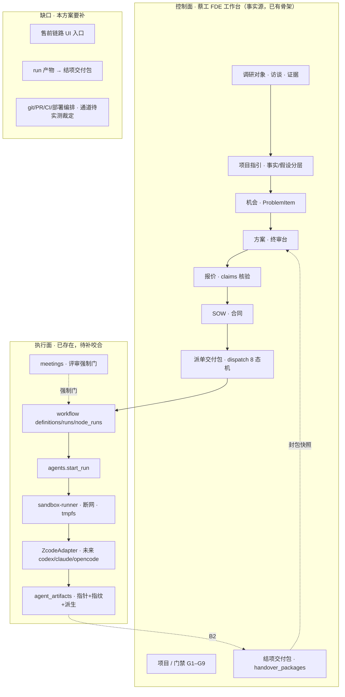

# 售前驱动交付模式改造方案（v1.2）

> 版本：v1.2 ｜ 日期：2026-11-06 ｜ 议题：把蔡工 FDE 工作台从「业务项目与文档工作台」升级为「售前驱动的智能交付平台」
> 来源：2026-11-06 与用户的商业模式讨论（售前访谈 → AI 诊断 → 对症方案 → 签约 → 智能体交付）
> 证据口径：本文所有「现状」主张均以 2026-11-06 仓库代码实测为准（文件:行号）；**原始对话中的现状描述有若干已过时之处，本文逐条校正（见 §2）**。
> 状态口径：现状部分 **VERIFIED**；目标架构与新增能力 **PROPOSED**；商业判断 **CLAIM（待拍板）**。
> **v1.1 变更（2026-11-06）**：Q1–Q7 七项决策已由用户交互式拍板完成，§10 由「待拍板清单」改写为「决策台账」，§7 实施顺序按决策修订。
> **v1.2 变更（2026-11-06，多专家评审复审后）**：
> ① 经五专家 party mode 评审（`docs/audit/售前驱动交付模式改造方案-多专家评审-2026-11-06.md`）修订 **13 项 P0 + 10 项 P1 + 7 项 P2**；
> ② **Q2 改判**（录音转写落草稿区、人工整理后才入正式库）、**Q6 改判**（执行通道拆分延后、先实测再裁）、**Q3/Q5/Q7 校准**（权限表述 / provider 根因 / 服务端需补 2 条列表路由）；
> ③ §2.3 G2 订正为「S3 闸已落地，缺的是桌面提示」；
> ④ §7 第一阶段拆为 **T-A1..T-A8** 八轮，第五阶段拆 A/B/C 三类；
> ⑤ §8 指标重写（区分 live / simulation，新增数据源与可反证列）；
> ⑥ 新增 §11.1 未结案项清单。

---

## 0. 结论先行

**可以改造，且方向成立。但产品定位不能停在「会调用编码智能体的工作台」，而应是：**

> **以业务证据、方案、报价和门禁为核心，以编码智能体为执行器，以人类 FDE 为责任主体的智能交付平台。**

三点必须先说清楚：

1. **原对话的「现状盘点」大面积过时。** 编程执行层（沙箱、`ZcodeAdapter`、`agent_artifacts`、workflow agent 节点、评审会 `meetings`）**已经全部落地**。真正的缺口不是「接一个编码 CLI」，而是**售前链路本身**（访谈 → 事实/假设分层 → 机会 → 方案 → 报价 → SOW）的桌面入口与合同闭环，以及**执行层与业务层的咬合**（run 产物如何变成可签约的交付包）。
2. **可以替代大量重复性工作和标准化编码，不可以取消工程师的责任主体。** 编码智能体能干活，但不能对客户结果、法律责任和生产事故负责。门禁的人工拍板权不可让渡。
3. **最该先做的不是接第三个编码智能体，而是打通「访谈 → SOW」。** 这条链打通后，即便不接任何编码智能体，也能大幅降低售前对工程师的占用——投入产出比最高、风险最低。

> **v1.2 复审补记**：本文经五专家 party mode 评审后，第 1 点进一步收窄——**「执行层」本身已存在，但「执行通道」尚未打通**（服务端容器 spawn 不到任何宿主侧编码 CLI，见 §10 Q6 改判）；第 3 点保持不变，并已拆为 **T-A1..T-A8** 八轮（见 §7）。**新增第五点**：
> 5. **两个交付包不是一回事**：派单态 `delivery_packages`（已存在）与结项态 `handover_packages`（待立）不可混用，产物闭环指向后者（见 §3 命名澄清）。

---

## 1. 商业模式主张（CLAIM，待拍板）

用户主张的核心命题：

> 让经过短期基础培训的 FDE 业务代表做售前（访谈 + 调研），资料输入工作台由 AI 梳理出问题并给出对症解决方案，方案直接用于谈签约合同；这样就不用养太多 FDE 工程师，只需多养「懂一点 FDE 的售前」，大部分交付由蔡工 FDE 工作台（编码智能体）承担，或售前与工作台协作交付。

**本方案对这一主张的裁决：方向成立，但需要三处修正。**

| # | 原始主张 | 裁决 | 修正要点 |
|---|---|---|---|
| 1 | 「工作台需要变成编程智能体/编程工作台才能承担大部分交付」 | **部分不成立** | 工作台的编程执行层**已经存在**（`agents/` + `sandbox-runner` + `workflows` agent 节点）。缺的不是编程能力，是**售前到签约的证据链**和**执行产物到交付包的闭环**。把它当「编程工作台」是定位误判，会把已有的交付管理系统当成执行器来重造。 |
| 2 | 「大部分交付可通过工作台交付」 | **成立，但需能力分层** | 标准化程度高的部分（部署脚本、前端脚手架、文档、迁移草稿、重复性分析）可由智能体主导；涉及生产数据、复杂硬件、强监管、客户组织问题的部分必须人类主导。已有 `dispatch.agent_assisted_declare` 正是表达这种「接单人声明采用智能体协同」的既有机制。 |
| 3 | 「不用养太多 FDE 工程师，只需多养售前」 | **方向成立，但表述要改** | 有价值的转型不是「少养工程师、多养销售」，而是：**多养懂客户、懂 FDE 流程、能组织证据和验收的售前；少养大量重复编码、查资料、写文档、做基础测试的工程师；保留少量高能力专家。** 工程师从「施工者」变成「监理与验收者」。 |

---

## 2. 现状校正（VERIFIED，代码实测）

原始对话的「现有工作台已经具备哪些基础」一节大体正确；**「现在缺的不是接一个编码 CLI，而是编程执行层」一节则严重过时**。逐条校正：

### 2.1 已被推翻的说法

| 原对话说法 | 实测结论 | 证据 |
|---|---|---|
| 「没有暴露通用的『创建并启动一次编码智能体运行』接口」 | **不成立**。已有完整 run 接口族 | `server/src/fde_api/agents/routes.py:42`（POST `/<agent_id>/run`）、`:53`（run 详情）、`:60`（handoff）、`:67`（retry）、`:75`（tool-calls）、`:84`（cost）、`:97`（fallback-rehearsal）、`:104`（recover）、`:111`（pilot-report）、`:118`（quota） |
| 「尚未看到仓库克隆、Git 分支和 worktree 管理」 | **不成立**。openfde 侧已有完整 worktree 生命周期；工作台侧沙箱已实现 | `openfde worktree list/open/remove`；工作台沙箱 `server/src/fde_api/agents/sandbox.py:218`（create）、`:287`（exec_argv）、`:306`（exec） |
| 「没有隔离代码执行环境」 | **不成立**。`sandbox-runner` 服务已存在 | `compose.yaml:130-155`：`privileged: false`、`network_mode: none`、`tmpfs: /workspace:size=512m`、`profiles: [sandbox]`（默认不启动，试点 gate 才开） |
| 「插件机制并不是天然的任意 Shell 执行器」 | **成立且正确**——这是好设计，应保留 | `agents/sandbox.py:57` egress 默认 deny（`--network none`）；`:266` `--network` 参数化 |
| 「当前 AI Server 运行时还需要启用和配置」 | **部分过时**。DSH 运行时已有 enabled/runtime_version 抽象与健康回报，**且配置默认为关闭** | `server/src/fde_api/control/dsh_runtime.py:36,45-53`；`control/mcp_gateway.py:217` 回报 `ai_server_enabled` / `runtime_version`。**代码事实**：`server/src/fde_api/config.py:80` `dsh_enabled: bool = False`（默认关闭）；`.env.example` 无任何 dsh 条目（`grep -in dsh .env.example` 零命中）。本机是否实际启动仍属运行态，不作断言 |

### 2.2 已核实成立的能力（原对话说对了，且比说的更完整）

| 能力 | 实测位置 |
|---|---|
| 事实/假设/待确认的**分层**已内建 | `server/src/fde_api/guidance/ai_schema.py:6` `CLASSIFICATIONS = {customer_stated, ai_synthesized, ai_inferred, open_question, human_added}`；`:60` evidence 引用必须命中 `source_refs`，否则 `unknown_source_ref` 拒收 |
| ProblemItem 的可签约优先级与模块映射 | `ai_schema.py:18-20`：`SEVERITIES = (high, medium, low)`、`ITEM_OPTIONAL_KEYS = {severity, module}`（仅对 `key_business_problems` 放开，其余 10 字段维持精确键集防漂移） |
| 方案 → SOW 冻结导出，AI 不二次改写 | `api_catalog.py:61`「将已保存方案版本导出 SOW，内容保持原样，不重新 AI 推演」；`solutions/service.py:669` `export_sow` 强制传 `version` |
| agent 协同方案的 SOW 终审闸（防 AI 协同绕过人工） | `solutions/service.py:673-684`：agent_assisted 包绑定的方案，导出 SOW 前必须终审台拍板通过，「未 approved 的 AI 协同方案一个字节都不出系统」；闸独立成事务，拦下时兜底开闸先提交再抛 409（T-P0-1 死锁修复） |
| 报价的档位/系数/锚点/claims 核验链 | `server/src/fde_api/projects/quote_service.py`：`:137` B 层系数 = 0.9 + 总分×0.03；`:226` `_advance_claims` 逐字段推进 estimated→claimed；`:581` finalize；`:861` `claims_summary`（accepted/total） |
| 报价核验与 SOW 分离 | `api_catalog.py:79` `dispatch.packages_create` 需 `solution_id + quote_id` 建交付包 |
| 智能体运行与人工接管 | `agents/service.py:664` `start_run` / `:882` `handoff_run`（L3 转人工）/ `:927` `retry_run`（幂等）/ `:1023` `rehearse_fallback`（降级演练）/ `:1077` `recover_run` |
| 产物落库与指纹 | `agents/models.py:127` `AgentArtifact`；`:146` `AgentToolCall`（含 denied 留痕） |
| 智能体协同声明（接单人主动声明） | `api_catalog.py:118` `dispatch.agent_assisted_declare`：声明后才启用 T1–T6 评审门与溯源联动，难度 high 禁声明，8 态机零改动 |
| 能力档位实时重判 | `server/src/fde_api/control/access.py:72-75`：`agent.plan.generate`≤project_operator / `agent.code.write`≤project_manager / `agent.meeting.convene`≤project_operator / `agent.system.tool`=system_operator |
| 四类工作流节点全落地 | `server/src/fde_api/workflows/executor.py:78` `SUPPORTED_NODE_TYPES = ("call", "skill", "agent", "human_approval")`；agent 节点走 `agents.service.start_run` 同闸全链（`:912`、`:1027`），幂等键 `wfnode-{行id}:{attempt}` |
| 评审会与强制门 | `server/src/fde_api/meetings/routes.py:35-88`：创建/详情/插话/关闭/纪要/模板/清单/暂停/恢复/成本共 **10 条**（模块 docstring 自述「9 路由」已过时）；`meetings/service.py:436` 调 `authorize_ai_capability(user=actor, capability="agent.meeting.convene", project=project)` |
| 脱敏上下文渲染（进沙箱的唯一输入） | `agents/service.py:332` `_render_context`：只写代号 + 已确认 ProblemItem + 方案骨架 + 知识片段，禁区词/非法条目 **fail-closed 422**，绝不 500 裸抛；`:363` `_write_workspace` 写红线三文件（context.md / 任务书 / AGENTS.md 纪律） |
| 门禁人工拍板不收进 AI 工具面 | `api_catalog.py:121-136`：人工拍板类路径永不收编；`CONFIRMATION_KEYS = {solutions.export_sow, documents.generate}` |

### 2.3 真实缺口（这才是该投钱的地方）

| # | 缺口 | 证据 |
|---|---|---|
| G1 | **售前链路的桌面入口不全**。调研表三态流转（confirm/reject/revise）无 UI 入口，是「调研 → 方案」链路的真实断点（**2026-11-06 T-A3 已补齐桌面入口**，服务端零改动） | `docs/后续需求台账-F5与D11.md` §一 第 1-3 条：三个端点 desktop 0 引用，服务端状态机已完整 |
| G2 | **预调研录入卡的 S3 前置闸「缺独立路由」，但闸本身已落地**。`_require_s3_gate` 已在 `set_presurvey_source`（`:41`）与 `create_analysis`（`:63`）**两处强制调用**，未通过即抛 409 `presurvey_s3_gate_open`；文案与 G3 `evidence_checklist`（SOW-A 签署 / A 款预付到账 / 数据授权书四项）逐项对应。**真实缺口只是桌面端没有可读的拦截原因与跳转** | `server/src/fde_api/guidance/service.py:402-416`（闸）、`:41`/`:63`（两处调用点）；`server/seeds/gates.json` G3 `evidence_checklist` |
| G3 | **录音转写链缺失**。`ai/kimi.py` 与 `control/chat.py` 里的 "transcript" 均指对话转录文本，不是音频转写。访谈录音→文字这条链在代码中不存在 | `grep -rln "transcri\|audio\|录音" server/src` 仅命中这两处且语义不符 |
| G4 | **服务端无 git/worktree/PR/CI/部署编排**。`grep -rln "worktree\|git " server/src` 零命中；PR/部署/回滚无对应服务层 | 同上（`worktree`/`git` 在 `server/src` 无命中） |
| G5 | **DSH 配置默认关闭**。`config.py:80` `dsh_enabled: bool = False`，`.env.example` 无 dsh 条目 ⇒ 适配层从未启用，符合借鉴总览 Q8「维持 `dsh_enabled=False`」裁决 | `server/src/fde_api/config.py:80`；`grep -in dsh .env.example` 零命中 |
| G6 | **agents/meetings 缺桌面控制台**。桌面端仅有 `pilot/PilotReportPage.tsx` 与 `solutions/QuotaMeter.tsx` 引用 agents，**没有 run 列表、run 详情、tool-calls、tool-calls 详情、cost、meetings 的完整 UI** | `desktop/src/renderer/src/` 目录清单：`pilot/`、`guidance/`、`solutions/`、`workflows/` 存在；无 `agents/`、无 `meetings/` |
| G7 | **执行产物 → 交付包 的闭环未打通**。`agent_artifacts` 有 sha256，但与 `handover_packages`（D11 台账 §十三.4 已裁决的命名）未关联 | `docs/后续需求台账-F5与D11.md` §十三.4；`agents/models.py:127` |
| G8 | **录音转写须落草稿区，不得入正式库**。SOP 原文 `somwyn/raw/2026-10-27-FDE接触调研阶段资料入库SOP设计.md:109` 逐字为「⚠️ **只转写不入正式库**，且必须先获口头同意」，`:111` 补充边界「企业主动发给你的文字可以存；你录的音不能存」。⇒ 已在 §10 Q2 改判为「草稿区 + 人工整理晋升」 | `D:/test/FDE/engagements/openfde/engagements/somwyn/raw/2026-10-27-FDE接触调研阶段资料入库SOP设计.md:109`/`:111` |

---

## 3. 目标架构：控制面 + 执行面（PROPOSED）

原对话的「工作台做控制塔，编码智能体做施工队，人类专家做监理和验收」这个比喻是对的，本方案沿用并把它落到已有的实体上。



> **v1.2 命名澄清（P1-5 / 架构官 E-6）**：本文的「交付包」有两个不同实体，**不可混用**——
> - **`delivery_packages`（派单态交付包）**：`dispatch/models.py:40-78`，8 态机 + `package_code` + `dispatch_round` 唯一键 + `sow_type` ⇒ 图中 `PKG`，**已存在**。
> - **`handover_packages`（结项交付包）**：`docs/后续需求台账-F5与D11.md` §十三.4 **已裁决的命名**（`status` draft→sealed→delivered + `manifest_sha256` + 逐项 sha256 校验）⇒ 图中 `HPK`，**待立**。
> - 本方案 §7 第二阶段的「产物 → 交付包闭环」指的是 **`handover_packages`**，不是派单态包；封包前置 = D11 立项拍板 + 首批真实数据到位。
> - 借鉴总览 #6 的归属纪律：`ART -.B2.-> HPK` 是**指针 + 指纹**的引用关系，**不是复制原件**。

### 3.1 为什么不让 AI 直接出合同（红线，不可让渡）

- **AI 可以填、可以查、可以给建议；AI 不能改法律条款，不能代替人拍板。** 这与仓库既有纪律一致：门禁三条路由（提交证据 / 人工核验）**有意不进 api_catalog**（`docs/后续需求台账-F5与D11.md` §三），AI 不代执行、更不代拍板。
- **报价 claims 未核验、实际工时与成交价未回填时，不能直接拿来签合同。** 这是既有实现纪律（`quote_service.py` 的 `_advance_claims` / `finalize_quote`），不是新增约束。
- **SOW ≠ 完整合同。** 正式签约还应包含经法务批准的：保密协议、数据处理条款、客户配合义务、验收窗口、付款条件、知识产权、第三方软件与开源许可、变更管理、售后与支持、责任边界。AI 可以做**检查清单与缺项提示**，不能自行改写这些条款。

---

## 4. 七阶段 SOP（PROPOSED，含与现有能力的映射）

| 阶段 | 目标 | 现有能力 | 缺口 | 谁负责 |
|---|---|---|---|---|
| S1 售前准备 | 项目立项、选行业模板与首期模块、拿到访谈提纲与风险提示 | `guidance` presurvey source/intake | 提纲模板化（G6 附近） | 售前 |
| S2 访谈与采集 | 录入客户原话、现状流程、问题证据、已有数据系统、业务目标与限制 | `research` subjects/links/forms、`guidance` 上传与提炼 | **录音转写（G3）、事实/假设分层的 UI 表达（G1）** | 售前 |
| S3 诊断与机会 | 提取核心问题、根因、影响角色与流程、基线数字、业务价值、前置条件、待确认项 | `ai_schema.py` 五分类 + `source_refs` 强制 + `severity`/`module` | 机会落库前的人工核验 UI（G1） | 售前 + 方案负责人 |
| S4 方案设计 | 问题陈述 / 基线 / 目标态 / 三选项与取舍 / 推荐 / 交付物 / 明确不做 / 验收标准 / 数据依赖 / 里程碑 / 风险 / 客户需提供的资源 | `solutions.skeleton`（模板草稿）、`solutions.organize`（AI 建议不落库）、`solutions.health`（模板覆盖率/引用完整性/报价合法评分） | 终审台 UI 已有（`solutions/SignoffConsole.tsx`），需接三选项与取舍 | 方案负责人 |
| S5 报价与签约 | 档位/系数/锚点/工时/建议价/收款计划程序化计算 | `quote_service` 全套 + claims 核验 + `render_quote_draft` | **合同模板与法务条款清单（新建，非 AI 职责）** | 售前 + 负责人 |
| S6 交付编排 | 签署后拆任务包：目标、范围/非目标、验收标准、方案与证据快照、仓库与环境、测试命令、安全限制、预算与截止 | `workflows` 定义/校验/执行、`dispatch` 8 态机 + `agent_assisted_declare` | **git/PR/CI/部署编排（G4）、任务包与方案快照的绑定** | 编排中枢 + FDE |
| S7 评审验收归档 | run 产物 → diff/测试/制品/风险/成本 → CI → 人工代码审查 → 客户演示 → 人工验收 → 产物登记 → 门禁证据提交 → 人工核验 accepted | `agent_artifacts` + `meetings` 强制门 + `gates` 证据链 + T-G1/T-W7 证据候选 | **run 产物 → 交付包（G7）、agents/meetings 桌面控制台（G6）** | 人类 FDE（不可让渡） |

### 4.1 三种交付模式（按风险分流）

| 模式 | 触发条件 | 智能体职责 | 人类职责 |
|---|---|---|---|
| **平台主导** | 标准化程度高（部署脚本、前端脚手架、文档类） | 编码、测试、文档 | 抽查 |
| **智能体 + 人类专家** | 有集成复杂度但可控 | 编码、初版测试 | 架构、代码审查、客户集成、上线 |
| **人类主导** | 生产数据 / 复杂硬件 / 强监管 / 客户组织问题 | 只做分析与文档辅助 | 全程主导；工作台只负责协调与留痕 |

选择权在接单人手上——`dispatch.agent_assisted_declare` 就是这个开关（难度 high 禁声明，声明后才启用 T1–T6 评审门与溯源联动）。

### 4.2 每次 run 必须返回的结构（PROPOSED，补齐现有 Artifact 字段）

```
branch / commit · changed_files · diff · test_results · build_results
lint / security_scan · known_risks · artifact_references · logs
token / duration / cost · sha256
```

**现状差距**：现有 `agent_artifacts` 有 sha256，但**没有 diff 与 test_results 的结构化落库字段**；`AgentToolCall` 记 denied 但不记测试结论。这是 G7 的一部分。

**v1.2 补（P1-2 / P1-4）**：
- **落库形态必须是「指针 + 指纹 + 可重建派生」**（借鉴总览 #6《状态归属与对账-v1》§1 不变量「引用方永不复制真相，只持指针；证据原件永不入库」）——`storage_ref` 指向 diff / test_results 原件（留项目工作目录）、`sha256` 记指纹、结构化摘要（passed/failed 计数、退出码）作为**可从原件重建的派生**。现有模型 `agents/models.py:137-138` 的 `storage_ref` + `sha256` 即是此形态，扩列须沿用，不得复制原件进库。
- **模块边界**：新字段**只写不读**，dispatch 侧取数走 `project_evidence` 指针，避免 agents/dispatch/solutions 成环（否则须扩 `test_architecture_purity.py` 断言范围）。
- **显式声明 #3 红线**：diff / test_results 由**执行侧**（沙箱内跑测试）产出；**审查侧只读快照，不检出、不运行被审代码**（`AGENTS.md` 红线第 7 条）。
- **与 #2 回执终态对齐**：回执面损坏已有独立终态 `succeeded_but_receipt_invalid`（`agents/models.py:66` status CHECK；`agents/service.py:472`），本节产出字段不应与之重复造终态。
- **成本字段不新增存储**：`token_cost` / `duration_ms` / `max_cost_units` 已存在（`agents/adapter.py:66-76`、`agents/models.py:52-53`），`cost` / `logs` 只作派生展示。

---

## 5. 编码智能体接入规范（PROPOSED）

### 5.1 统一适配器协议

业务工作台只认识「编码智能体」，不绑定厂商。现有 `ZcodeAdapter`（`agents/adapter.py:105-108`，`kind = "zcode"`）已经走对了方向——**扩展它，而不是另起一套**。

```
prepare_workspace · validate_request · run · collect_result · cancel · health_check
```

统一输出：`status / summary / changed_files / commit+diff / test_results / artifact_references / known_risks / cost / logs / sha256`

**v1.2 补（P1-3 / 架构官 P1-4）**：

| 六方法 | 现状 | 落点 |
|---|---|---|
| `prepare_workspace` | 不存在 | 沙箱侧已有 `sandbox.py:218` create + `_write_workspace`（`agents/service.py:363`）⇒ 可复用，只做适配器薄封装 |
| `validate_request` | 不存在 | 新增；`AgentRunResult` 已有 `degraded` / `degraded_reason` 字段（`adapter.py:66-76`）可承载降级语义 |
| `run` | **存在**（`adapter.py:119`），但**调用契约与真实 zcode CLI 不匹配** ⇒ 须重写 | 见 §10 Q5 落地约束 |
| `collect_result` | 部分（`_judge_tool_call` `adapter.py:195`） | 新增结构化产物收集 |
| `cancel` | 不存在 | `AgentRunResult` 已含 cancel 语义字段；执行侧由沙箱超时/心跳 kill 承担 |
| `health_check` | 不存在 | 与 `agents/service.py:182` 的 `adapter_missing` 判定合并 |

- **与 #14 的同源性**：本节六方法协议正是借鉴总览 #14「executor 对抗性测试组织」的**前置重构形态**（总览明示前置＝「决策逻辑抽纯函数，2–3 周重构」）⇒ **须合并实施，避免二次立项**；但**第三阶段只做 zcode 单适配器落地，不预支协议抽象**（先跑通单点，抽象留到第二家接入时）。
- **#4 purity 边界**：适配器落在 `agents/` 模块，不在 `workflows/` 内核包 ⇒ 不触碰 `test_architecture_purity.py` 的断言范围（该测试只扫 `workflows/`）。

### 5.2 接入三家前必须逐项确认（zcode 尤其）

| 必答项 | 为什么 |
|---|---|
| 是否有稳定 API 或 CLI（非交互） | 只有人工交互界面的工具**不适合**作为工作台执行器 |
| 能否指定工作目录与模型 | 否则沙箱隔离形同虚设 |
| 能否返回结构化结果 | 否则产物只能靠扫目录猜，与 `agent_artifacts` 的 sha256 链断裂 |
| 是否有会话恢复与取消机制 | 沙箱有超时与心跳 kill，CLI 没有恢复就是半拉子 |
| 凭据如何托管 | 现纪律：`agent_credentials` Fernet 加密，**仅经 `docker exec -e` 注入容器进程**，宿主 shell 历史/日志不落明文，run 结束凭据随容器销毁 |
| 是否允许商用与多租户隔离 | 商用责任落在主体公司 |
| 版本如何钉死 | 已有先例：`docs/试点前联调-iptables与zcodeCLI-检查单.md` 要求钉死 zcode CLI 版本 + 二进制 sha256，防供应链漂移 |

### 5.3 执行隔离红线（既有纪律，照抄执行）

- 每次 run 独立容器 / 独立 worktree；**只挂 workspace**（`sandbox.py` 单 bind mount 纪律）
- 默认 `--network none`；需要外网走 per-run 网络 + iptables 白名单（`sandbox.py:57`、`:143`、`:266`）
- **绝不挂真相层**（`D:\test\FDE\…`）、`.env`、任何密钥文件
- 凭据经 Secret Broker 临时注入，run 结束销毁
- 禁止默认访问生产数据库 / 默认部署生产 / 直接推送主分支
- 安装依赖、访问外网、部署 → 人工审批（`automation_approvals` 既有闸：`(run_id, request_key)` 唯一 + `arguments_sha256` + 15min + 一次性 + 执行前再鉴权）

### 5.4 不要让供应商侵入主 API

现有架构的纪律是对的：API 创建 run → 队列调度 → 隔离 Runner 执行 → 收集产物 → 持久化 run/tool_calls/cost/指纹 → 人工评审。**不要在工作台后端进程中直接执行任意命令行。**

---

## 6. 人员结构与能力分层（PROPOSED）

| 角色 | 核心职责 | 能否被智能体替代 |
|---|---|---|
| FDE 售前代表 | 访谈、建立信任、录入事实、确认需求、讲解方案 | 部分（记录可自动化，关系与判断不可） |
| 解决方案负责人 | 审方案、技术可行性、范围与风险把关 | 否 |
| 编码智能体 | 编码、测试、文档、迁移草稿、重复性分析 | 就是它本身 |
| 现场/专业 FDE | 客户现场、数据接入、硬件、复杂集成、生产问题 | 否 |
| 管理员与质量负责人 | 权限、模型、插件、审计、抽检和指标 | 否 |

**能力等级（建议用平台机制硬约束，而不是口头承诺）**：访谈助理级 → 独立售前级 → 方案审核级 → 交付专家级。可用**必填项、问卷完整度、AI 补问、历史质量数据**控制售前代表能推进到哪一步。

> ⚠️ **落地前必须查清一个数据边界**：`guidance` 的上传入口是否允许售前代表上传含客户真实名称的文件。AGENTS.md 红线：「客户真实资料永不进 git 历史与远端：仓库和数据库只存代号（如 somwyn）」，且 somwyn 的 Never violate 里有「代号化红线」与「raw/ 只增不改」。**这条直接决定「售前上传访谈资料」这条路能不能走通、怎么走。** 本文档不臆断其现状，列为待拍板项 Q1。

---

## 7. 实施顺序（按投入产出比排序，不按技术酷炫度）

> **v1.2 校准（P0-11）**：v1.1 把第一阶段打包成 8 个子项，据落地官核对，仓库既有节奏是**一个 T 项一轮**（T-W1..T-W5、T-S1/T-S2、CR-006 每轮单点，多数「零迁移零路由」）⇒ **第一阶段工作量被低估约 4–6 倍**。下表按 T 轮拆开，**每轮独立可验收、可独立回滚**。

### 第一阶段：打通「访谈 → SOW」（不接任何编码智能体）—— 拆为 8 个 T 轮

**这一阶段独立产生价值，且是所有后续阶段的前置。**

| 轮 | 内容 | 迁移 | 路由 | 复杂度 |
|---|---|---|---|---|
| **T-A1** | presurvey S3 前置闸的**桌面提示与拦截反馈**（闸已落地于 `guidance/service.py:402`，本轮只做可读原因 + 跳转） | 零 | 零 | S |
| **T-A2** | 代号化自动替换层（词典入 DB + 非-AI 纯函数替换 + 哨兵自测 + CI 词典一致性断言） | 新增 | 零 | M |
| **T-A3** | 调研表三态 UI 入口（confirm/reject/revise，按 §10 Q3 校准后的权限显隐）——**2026-11-06 已实施** | 零 | 零 | M |
| **T-A4** | 事实/假设/待确认三层在桌面端可见可编辑（客户原话 vs AI 推断视觉可分）——**2026-11-06 已实施** | 零 | 零 | M |
| **T-A5** | 方案三选项 + 取舍 + 明确不做 + 验收标准 骨架模板（复用 `solutions/service.py:895-945` 既有六段骨架；**2026-11-06 已实施**——口径校准：既有六段里 `out_of_scope` 只混排在 risks 段，「明确不做」为**新增独立段**；桌面通用 Markdown 渲染，零改动） | 零 | 零 | S |
| **T-A6** | 报价 claims 核验 → 冻结 SOW 的 UI 闭环（**2026-11-07 已实施并合并** PR #175 → `0a7806b`——口径校准：`export_sow` 不查报价（SOW 是谈判材料），真正的报价闸在交付包发布 `quote_not_finalized`；实施为方案详情页「建交付包」入口（复用既有 `POST /dispatch/packages`）+ 报价卡成交后引导行，服务端零改动） | 零 | 零 | S |
| **T-A7** | 客户谈判版本管理（**2026-11-07 已实施并合并 #178 → `9267240`**——拍板 6③ 落地：复用 solution 版本行，谈判稿=未冻结版本；桌面详情页冻结状态徽标（反查 SOW 快照 `opportunity_scope.solution.version`）+ 导出弹窗明示冻结版本与复用；「SOW 与冻结版本逐字一致」服务端既有用例钉住，零重复实施） | 零 | 零 | S |
| **T-A8** | agents run 列表 + meetings 会议纪要两个控制台（**含服务端补 2 条列表路由**） | 零 | **+2** | M |

**建议串行序**：T-A2（代号化，数据流前置）→ T-A1（闸提示）→ T-A3/A4（桌面并行）→ T-A5/A6/A7（业务闭环收尾）→ T-A8（控制台，可与 A5-A7 并行）。

> **✅ 登记完成（2026-11-06）**：本节 T-A1..T-A9 与 T-B1 / T-Z1 **已登记进 `docs/implementation/v3-backlog.md` 新增节「售前主线登记（T-A 系列）」**，11 条**全部 PROPOSED（零代码零迁移零路由）**，逐条含现状实测/改动面/DB·API 口径/测试/验收/回滚/闸；依赖图与 §拍板闸第 6 条同步更新。**登记≠排期≠实施授权**——逐条闸须在各自实施轮启动前满足。

**出口指标（v1.2 校准）**：一个**代号化仿真项目**能从访谈走到合格方案 + 冻结 SOW，每一步都有来源、版本、责任人和证据。
> **v1.2 校准**：原写「一个**真实客户**项目」——真实客户资料不可作测试素材（AGENTS.md 红线），改为仿真口径，真实项目后置替换。

**回归风险提示（测试官 R-12）**：research 域现有 **222 例**（服务端 99 + 桌面 123）压在三态链路上；T-A3/A4 改前端数据契约（状态映射、乐观锁 version 传递）时回归面巨大。

### 第二阶段：补执行层的桌面控制台（G6）+ 执行层咬合

**v1.2 合并 v1.1 第二/三阶段的前半**：控制台（T-A8）与执行层咬合合批，因为两者共用 `agent_artifacts` 的字段语义。

- agents run 列表/详情/tool-calls/cost + meetings 会议与纪要 + workflow 控制台（已有 `WorkflowConsole.tsx`）三者打通成「一个交付看板」
- `agent_artifacts` 增加 diff / test_results 结构化字段 —— **落库形态必须是「指针 + 指纹 + 可重建派生」**（借鉴总览 #6「引用方永不复制真相，只持指针」）：`storage_ref` 指向原件（留项目工作目录）、`sha256` 记指纹、结构化摘要（passed/failed 计数与退出码）作为可从原件重建的派生
- **模块边界裁决（P1-4）**：新字段**只写不读**，dispatch 侧取数走 `project_evidence` 指针，避免 agents/dispatch/solutions 成环
- 产物指纹接入 `handover_packages` 封包（**命名按台账 §十三.4 已裁决的 `handover_packages`**，避与派单态 `delivery_packages` 撞名；封包前置 = D11 立项拍板 + 首批真实数据到位）
- **迁移纪律（P1-6）**：artifacts 扩列 = **additive-only 新迁移** + `test_migrations` HEAD 钉 + 版本号同步（`desktop/package.json` + `server/pyproject.toml`）+ rebuild 后 `alembic upgrade head`；**不得修改已发布迁移**

理由：执行面已存在但**看不见**。人看不见的自动化等于没有自动化——尤其对「售前 + 少量专家」的新团队形态。

### 第三阶段：zcode 真机跑通 + 执行通道裁定

- PATH wrapper + provider 配置补齐（**根因是路径错位，修复＝部署到 `D:\config\provider\`**）+ 沙箱镜像版本钉死 + 试点前联调检查单执行（人工项）
- **`ZcodeAdapter` CLI 调用段重写**（按真实 CLI `zcode -p/--mode/--json/--cwd` 或 `app-server` stdio 协议）
- **执行通道半天实测 + 拍板**（见 §10 Q6 改判）：先测「zcode 能否进 `sandbox-runner` 容器内执行」→ 能则容器内直连 `ZcodeAdapter`（沙箱红线完整成立）；不能则在「给 openfde 加 zcode executor」与「自建 Windows 宿主侧 zcode 代理」之间定稿
- git worktree / PR / CI 编排层（**结论依赖上述实测**，不预先承诺复用 openfde）

### 第四阶段：接第二个编码智能体

**先做完一个供应商的端到端闭环，再抽象第二个。** 选择标准：企业支持完善、非交互调用稳定、权限与数据条款可控、成本可追踪、能返回代码/测试/日志。
> **防重复立项**：不得把 openfde executor 里的 claude/codex（`executors.ts:127/200`）当「第二家」直引——借鉴总览 #40 不做清单已登记。

### 第五阶段：生产交付与持续改进

**v1.2 拆 A/B/C 三类（按借鉴总览 §5.6 禁二次立项）**——原 v1.1 把 8 项并列成同一批「持续改进」，经可维护性官逐项核对，**8 项中 7 项已有载体或已登记裁决**：

| 类 | 项 | 归属 |
|---|---|---|
| **A · 已有载体，补缺口** | 部署审批 | 已落地：`control/models.py:163-200` `AutomationApproval`（request_key 唯一 + arguments_sha256 + 15min 过期 + risk_level CHECK） |
| | 回滚 | 已落地：`control/extensions_service.py:387` `rollback_skill` + `control/routes.py:107` + T-S1/T-S2 审计事件收口 |
| | 运行监控 | 已落地：`metrics/service.py:51` `build_metrics_report` |
| | 线上问题反馈 | 已落地：`mailing/models.py:82` `feedback_type` + `mailing/policy.py:44` `feedback_is_retryable` |
| | 交付物模板化 | 已落地：`templates/service.py`（`copy_template_version:393` / `publish_template_version:467` / `serialize_template_snapshot:630`）+ `DocumentTemplatesPage.tsx` |
| **B · 挂已登记项** | Skill 化 | 挂 **#36 技能结构化契约**（B#36）/ **#37 技能自洽校验**（B#37） |
| | 插件市场 | 挂既有 `control/dsh_market.py:24` `sync_dsh_market` + `:117` `search_dsh_market` + `control/routes.py:193/208` |
| **C · 真新建立项（须先走 backlog 登记轮）** | CI/CD | 新立；注意撞 #3「审查不执行被审代码」红线的边界，须先厘清 |
| | git/PR 编排 | 新立（与 §10 Q6 的执行通道实测结论强相关，见 O-1） |

> **§7 阶段与借鉴总览 §5 四态 / B# 编号是独立排期体系**，不互相覆盖；本文阶段负责「做什么」，B# 负责「借鉴登记排期」。

---

## 8. 成功度量（不要只看「生成了多少代码」）

**v1.2 重写（P0-12）**：原 v1.1 的 10 类指标**只有 2 类可测可反证**，且「工程师小时数」「交付毛利率」取自仓库自标「不冒充真实数据」的 simulation 口径。改为「过程指标 / 结果指标」分栏，并标注**数据源、是否可反证、口径**：

| 栏 | 指标 | 数据源 | 可反证 | 口径 |
|---|---|---|---|---|
| 过程 | 访谈 → 合格机会所需时间 | 调研表 revision 时间戳 | ✅ 可反证（超时即未达标） | live |
| 过程 | 方案从访谈到 SOW 的时间 | solution revision 时间戳 | ✅ | live |
| 过程 | G1/G2/G3 一次通过率 | gate revision | ✅ | live |
| 过程 | 人工返工率 | revision 版本差 | ✅ | live |
| 过程 | 编码智能体任务一次测试通过率 | **依赖 `agent_artifacts` 扩 test_results（第二阶段）⇒ 数据源目前不存在** | ⚠️ 需先补字段 | live |
| 过程 | 智能体产物被人工接受率 | `agent_artifacts.reviewed` **无写路径 ⇒ 接受率恒 0**（R-3） | ⚠️ 需先补写路径 | live |
| 结果 | G9 结果验收线达成率 | G9 `exit_condition`（`uplift_bounded ≥ 0.8 ∧ incidents = ∅ ∧ 三锚四反例全过`） | ✅ 但 **阈值 0.8 为占位待校准**（借鉴总览 R4 纪律），且 `uplift` / `kpi_oracle` 服务端零命中 ⇒ 当前不可机器判定（R-7） | live |
| **不可作商业主张验证依据** | 每个项目占用的工程师小时数 | **仓库自标 simulation 口径，不冒充真实数据** | ❌ | simulation |
| **不可作商业主张验证依据** | 交付毛利率 | 同上 | ❌ | simulation |
| 建议删除 | 客户现场问题数量 | 登记制 | ❌ 存在反向激励（不报即达标） | — |

**v1.2 增补（借鉴总览 #22 精神）**：每个指标增「**反例构造**」——能否构造一个「看起来达标但其实没做到」的情形；不能反证的指标不得进入验收线。

**最重要的验收条件（建议作为整轮改造的北极星）：**

> 一个**代号化仿真项目**能够从访谈走到 SOW、交付、验收和归档；每一步都有来源、版本、责任人和证据；**智能体不能越权修改、不能部署、不能自动过门**。
>
> **v1.2 校准**：原 v1.1 写「一个**真实客户**项目」，但真实客户资料不可作测试素材（AGENTS.md「客户真实资料永不进 git 历史与远端」红线）⇒ 出口指标改为「代号化仿真项目走通」，真实项目后置替换。

---

## 9. 红线清单（违反即事故）

沿用仓库既有红线，本方案新增 **6 条**（v1.2 由 4 条扩为 6 条）：

1. **AI 不代拍板**：门禁提交证据与人工核验继续不进 api_catalog；智能体不得自动把 claimed 变 accepted。
2. **AI 不出法律条款**：AI 可填可查可提示缺失项，不得改写合同条款；SOW 导出必须绑定已冻结的方案版本。
3. **执行面不可触真相层**：沙箱不挂 `D:\test\FDE\…`、不挂 `.env`；脱敏渲染 fail-closed；上下文渲染产物须通过真实客户名/盘符路径零命中断言（CI 已有 gitleaks，需再加一条脱敏断言）。
4. **售前代表不得代客户拍板业务结论**：售前录入的事实需客户确认；AI 推断与客户原话必须分层且可溯源。**（v1.2 细化；2026-11-06 T-A3 实施实测校准）**：售前可对**已确认表显式创建修订版**（revise）、不可**确认/否决事实**（confirm/reject 归 `can_manage`；「打回重填」在服务端实为 reject，同样归 `can_manage`）——见 §10 Q3。
5. **产出形态纪律**（v1.2 新增，借鉴总览 #6）：`agent_artifacts` 新增列只能是**指针 + 指纹 + 可重建派生**，**不得复制 diff / test_results 原件进库**；证据原件永远留在项目工作目录。
6. **审查不执行被审代码**（v1.2 显式引用 AGENTS.md 红线第 7 条）：AI 审查/评审的输入只能是 diff/文本快照；**不得检出、不运行被审交付的代码、测试、配置或 hooks**。diff / test_results 由**执行侧**（沙箱内跑测试）产出，审查侧只读快照。
7. **编码执行只在宿主侧**（v1.2 新增，随 Q6 改判）：服务端容器内**不得直连宿主 CLI**（openfde / zcode 均为 Windows 宿主侧 Node/Electron 工具，`bridge/__init__.py:3-8` 已明示容器 subprocess 够不到）；编码执行一律落在宿主侧进程空间，且容器内不挂真相层。

---

## 10. 决策台账 Q1–Q7（2026-11-06 用户拍板，v1.2 复审校准）

> 七项全部已决（用户交互式拍板）。本节记录**决策内容 + 依据 + 落地约束**，替代原「待拍板清单」。
> 状态：**DECIDED**（用户 2026-11-06 拍板）。**实现偏差须回写本节，并同时回写 `docs/implementation/v3-backlog.md` 与借鉴总览 §1 状态列**（借鉴总览 §5.6 纪律）。
> **v1.2 说明**：本文经多专家评审后复审，Q2/Q5/Q6/Q7 四项做了**校准或改判**（各节标有「复审校准/改判」说明），Q3 为权限表述校准。改动均以用户复审拍板为准，原 v1.1 结论作废处已逐条注明。

### Q1 代号化边界 —— 入库时自动替换为代号 ✅

**决策**：售前上传访谈资料时，服务端在入库前把正文中的真实企业名替换为代号（如「客户A」），原文留在本地 raw/ 不入库。

**依据**：
- `scripts/check-pseudonymization.sh` 只扫**数据库 dump**（`pg_dump --data-only --inserts`，`:104`），**不扫文件二进制内容** ⇒ 上传文件正文含真实企业名时 CI 门禁**静默通过**。替换必须在入库时做才可靠。
- `guidance/redaction.py:22` 的 `redact_text` 已在做手机号/邮箱/证件号脱敏，但**故意不脱企业名**（企业名不是 PII 格式）⇒ 企业名需单独一层。
- `projects.enterprise_code` 已是三段式代号（`client·industry·city`，格式检查见 `check-pseudonymization.sh:206`），替换目标可直接对齐。

**落地约束**（v1.2 补 P0-4 / P0-5）：
- **词典来源须脱离真相层**：`leads.md` 在真相层 `D:\test\FDE\leads.md`（经 `FDE_LEADS_MD` 注入），而 §5.3 红线「执行面不可触真相层」⇒ **词典必须抽到 DB 或仓库内**，执行面只读 DB。**注入机制**：沿用 CI 已有的合成 fixture 口径（`.github/ci-assets/synthetic-leads-blacklist.txt`，`ci.yml:85/105`），CI 侧继续用合成 fixture，服务端用 DB 词典。
- **替换层声明为非-AI 纯函数**（合借鉴总览 #31「导入零模型调用」）：字典匹配 + 确定性替换，**不调用任何模型**，替换行为可复现、可回归。
- **CI 侧与入库侧共用同一份词典**：CI 用它扫库（`check-pseudonymization.sh:91` 的中文 2–15 字 + 公司/集团/厂 结尾正则），入库用它做替换 ⇒ 建议把 bash/perl 侧提取收敛为 **Python 单点**（bash 调用），自测里断言「替换器词典 == CI 词典」逐条一致，消除「双向复用」目前只是文字承诺的风险。
- **补哨兵自测**（借鉴总览 #11）：注入合成企业名验证替换确实发生；**误替换须钉死**（正则固有会抓「技术公司」「制造公司」类通用词）——测试数据只用 `.github/ci-assets/synthetic-leads-blacklist.txt`，**真实客户资料不可作测试素材**（AGENTS.md 红线）。
- 替换发生在 `redact_text` 之后、落库之前；原文由售前自行留存于本地 raw/（遵循 somwyn「raw/ 只增不改」纪律）。
- **失败语义已拍板（2026-11-06，对应台账 §拍板闸 6①）**：**分层**——替换器**异常**（词典加载失败/正则编译失败等机制性故障）→ **fail-closed 硬阻断入库**（与 `_render_context` 422 先例同构）；**疑似企业名但词典未收录**（正则命中「技术公司」类通用词）→ **放行但记入待复核清单**，方案审核人 confirm 前必须复核。
- **实施澄清（2026-11-06 T-A2 实施轮）**：上条「放行」= **不阻断入库流程，原文不留库**——疑似名**同样被替换为代号**（替换目标 = `projects.enterprise_code` 首段，如「客户A」），替换后进复核清单；若按「原文不改直接入库」理解，真实名仍进库，代号化红线在文件正文面失守。**通用词例外**（「技术公司」「制造公司」等无辨识度表述）零改动、不进清单。
- **✅ T-A2 已实施（2026-11-06）**：三道防线落在 `guidance/jobs.py` worker 链——**进模型前**（全文唯一外界出口）→ **落库前**（模型输出回显兜底）→ **复核清单落 `operation_events`**（`guidance.redaction_review`，B#9 事实链可查）；词典 = `server/seeds/enterprise-names.txt`（合成示例）+ `FDE_ENTERPRISE_DICT` 现场补充；fail-closed 落 `failure_code=pseudonym_dict_unavailable`（不重试）。详见台账 T-A2 实施轮小节。
- **词典形态已拍板（2026-11-06，对应台账 §拍板闸 6②）**：**仓库内种子文件**（`server/seeds/`），CI 扫库与入库替换读同一个文件，零迁移零 DB 依赖。

### Q2 录音转写 —— 录音不存，转写落草稿区、人工整理后才入正式库 ✅（2026-11-06 复审改判）

**决策**：音频文件仅在本地临时留存并转写；**转写结果只入草稿区（不可引用、T+7 自动清理），售前人工整理为访谈纪要并经客户确认后才入正式库**。

> **改判说明（v1.2）**：本项 v1.1 原结论为「转写文字按企业主动发来的文字同等对待入库」。多专家评审（架构官 E-8）逐字核对 SOP 原文后判定该结论**越过红线**，本轮复审据用户拍板改判。原 v1.1 结论作废，以本条为准。

**依据**：
- **SOP 原文逐字**（`D:/test/FDE/engagements/openfde/engagements/somwyn/raw/2026-10-27-FDE接触调研阶段资料入库SOP设计.md`）：
  - `:109`「**AI 在接触阶段能做的三件事**…初诊录音转写（⚠️ **只转写不入正式库**，且必须先获口头同意）」
  - `:111`「**S2 明令「不录音转写入库」**…**边界是：企业主动发给你的文字可以存；你录的音不能存。** 这条线要守死，否则 S2 免费初诊就变成带录音的免费咨询。」
  - ⇒ `:109` 的「只转写不入正式库」比 `:111` 的边界句**更严**：连转写文字都不入正式库，不是「只禁音频」。
- **旧引证位置错误**：v1.1 把红线出处写为 `leads/forms/_TEMPLATE-初诊记录.md:4`（该文件在主仓不存在）与 `openfde fde -e somwyn` 的 Never violate 段（实际无「录音」条目，「S2」在该文件里是交付里程碑 slice）——两处均为错误引用，现已锚定真实原文。
- `ai/kimi.py:39-43` 实测：MiniMax 官方 purpose 枚举共 **5 项**（`voice_clone` / `prompt_audio` / `video_understanding` / `t2a_async_input` / `video_generation_input`），**无音频转写项** ⇒ 现成通道做不了 ASR，需另配通道（独立工作量项）。
- **草稿区语义与既有证据纪律同构**：ASR 文本是**未经客户确认**的中间产物，其状态等价于 `ai_schema.py:6` 的 `ai_synthesized` / `open_question`（claimed 而非 accepted），人工整理并经客户确认后才转为 `customer_stated` 入正式库。

**落地约束**：
- ASR 通道独立立项（不在第一阶段范围）；第一阶段先做**文字资料入库**，录音场景留接口位。
- 草稿区必须与正式库**物理隔离**（独立表 + 独立文件根），草稿行**不可被方案/报价/SOW 引用**，T+7 自动清理。
- 售前整理后的纪要须带**客户确认动作**（确认人、时间戳、确认方式），方可晋升为正式库证据。
- ASR 转写文本同样过 §10 Q1 的代号化管线（企业名替换），不因「草稿」而豁免。

### Q3 能力分级 —— 复用现有 project_access + 角色位阶，不新造体系 ✅（2026-11-06 复审校准）

**决策**：用既有 `role` 位阶（`viewer < fde_engineer < project_lead < admin`，`auth/models.py:13-18`）与项目成员角色（`member`/`viewer`，`workbench/models.py:333`）组合出四个准入闸，**不建新表**；**权限模型零改动**，「确认事实」维持为 `can_manage` 拍板权（见下方校准）。

> **校准说明（v1.2）**：v1.1 的四闸表曾写「独立售前 = fde_engineer + member ⇒ 确认事实」。多专家评审（架构官 E-5）核出与 `research/form_service.py:972` 的强制 `can_manage` 冲突——**member 的 `can_manage` 恒为 False**。本轮复审按用户拍板：**权限不动，改方案表述**。

**依据**：`projects/permissions.py:21` 的 `project_access` 已实现三层判定（admin / 项目负责人且 role≥project_lead / 成员角色），成员默认 `can_manage=False`（`permissions.py:32-41`）。

**调研表三态的实测权限闸（v1.2 新增事实）**：

| 动作 | 权限闸 | 位置 | member+fde_engineer 可否 |
|---|---|---|---|
| 填表 / 改答案 | `_require_fill`：`can_manage` **或** `can_update_assigned_tasks` | `research/form_service.py:966` | ✅ 可（`can_update_assigned_tasks` = role≥fde_engineer） |
| **revise**（**基于已确认版本显式开新修订**——非打回） | `_require_fill` | `research/form_service.py:568` | ✅ **可**（仅 confirmed 态；否则 409 `research_form_not_confirmed`） |
| **confirm**（确认事实） | `_require_confirm`：强制 `can_manage` | `research/form_service.py:972`、调用点 `:347` | ❌ 不可 |
| **reject**（**打回重填**：`review_comment` 必填、草稿保持可编辑） | `_require_confirm`：强制 `can_manage` | `research/form_service.py:532` | ❌ 不可 |
| presurvey 资料录入 | `_project(manage=False)`：仅查 `can_view` | `guidance/service.py:471-477` | ✅ 可 |
| 方案终审 / 导出 SOW | `require_project_manager` | `solutions/service.py:673` | ❌ 不可 |

⇒ **校准后的四闸**（「确认事实」= 拍板权归负责人，与 `claimed ≠ accepted` 证据纪律一致）：

| 能力等级 | 角色配置 | 可推进到 |
|---|---|---|
| 访谈助理 | viewer 成员 | 填表、提资料、录 presurvey，**不可确认/否决事实** |
| 独立售前 | fde_engineer + member | 填表、**对已确认表创建修订版（revise）**、录 presurvey 资料、生成方案草稿，**不可 confirm/reject 事实（含打回）、不可导出 SOW** |
| 方案审核 | project_lead 或项目负责人 | **confirm/reject 事实**、终审方案、导出 SOW（与 `export_sow` 的 `require_project_manager` 天然对齐） |
| 交付专家 | 可声明 `agent_assisted` | 走 dispatch 8 态机接单 + 智能体协同 |

**理由**：「确认事实」是**拍板权**，若由填表人自行确认，等于运动员兼裁判，事实质量失去第二双眼睛——与工作台既有的 `claimed ≠ accepted`、人工核验 accepted 才算数的纪律冲突。修订「事实由售前确认」→「事实由售前收集、负责人拍板」后，业务链路完全走得通，且**零服务端改动、零回归风险**。

**落地约束**：不新增职级表；映射写在服务端配置/常量，零迁移零路由新增；`dispatch.agent_assisted_declare` 已有「难度 high 禁声明」纪律，直接复用。**售前侧需配套**：桌面端三态按钮按权限显隐，售前可见「创建修订版」但不可见「确认事实」「驳回并留意见」，提示语要说清「事实确认与打回需项目负责人」。

> **2026-11-06 T-A3 实施实测校准（上位口径修正）**：v1.2 原文把 **revise 写成「打回重填」**，与服务端契约不符——`revise_form`（`research/form_service.py:561`）要求 `parent.status == "confirmed"`，做的是「**基于已确认版本显式开新 draft 修订**」（记事件 `project_research_form_revised`），而**打回重填在服务端是 reject**（`review_comment` 必填、草稿保持可编辑）——但 reject 归 `can_manage` ⇒ **独立售前并无打回权**。⇒ 校准后的售前权限：**对已确认表可创建修订版（显式留痕），对草稿表无任何三态动作**；打回与确认同归方案审核人。桌面三态入口已按此落地（`desktop/src/renderer/src/research/ResearchForm.tsx`）。

### Q4 合同条款 —— 正文留 openfde/fdeops，工作台只存指针与缺项检查 ✅

**决策**：法务条款正文维护在 openfde/fdeops；工作台只存签约日/账期/验收窗口/终止条款摘要 + **条款清单勾选项**；AI 只做缺项检查，不改写条款。

**依据**：
- `projects/contract_service.py:1` 文档头已明确「**只存指针与关键条款摘要**」；`:100` 附近校验 `source_uri` 必须以 `fdeops://` 或 `openfde://` 开头 ⇒ 正确落点本来就**不在工作台数据库**。
- `projects/CommercialBoard.tsx:212-220` 已覆盖报价/收款/合同三块的读与写（含 `calibrate` / `finalize` 按钮）⇒ **Q4 有现成 UI 落点**，只需加条款清单勾选。
- 与红线「AI 不出法律条款」一致。

**落地约束**：工作台新增的是**条款清单 + 缺项检查**（勾选项 + 未勾选阻断导出 SOW），不是条款正文存储。

### Q5 编码智能体 —— 先跑通 zcode，DSH 不作为第二家 ✅（2026-11-06 复审校准）

**决策**：以 zcode 为唯一优先编码执行器，先在真实环境跑出证据；**DSH 不作为第二家编码智能体**。

> **校准说明（v1.2）**：v1.1 有两处事实错误，本轮据代码官实测订正——① provider 配置**不是缺失**，是**查找路径错位**；② `ZcodeAdapter` 的**调用契约与真实 CLI 不匹配**，须重写。

**依据**（2026-11-06 实测）：
- zcode 确认已装：`D:\software\zcode`（Electron 应用，`ZCode.exe` + `resources/glm/zcode.cjs`），CLI 版本 **0.17.1**。
- zcode **有完整非交互能力**：`--prompt/-p`、`--mode`（build/edit/plan/yolo/guarded）、`--cwd`、`--json`、`--resume`、`--disallowed-tools`、`--target`、`--workflow-mode`，另有 **`app-server`（ZCode Protocol stdio）** 子命令。⚠️ `--resume` 实测为**布尔开关（`[["--resume"],0]`），无 `<sessionId>` 取值**——v1.1 写「`--resume <sessionId>`」不准确，**「会话续接」能力未验证**（借鉴总览 §6.6 采集项口径：未核实则以降级路径为默认）。⚠️ `--json` 事件流格式**未实测**（实跑被 429 截断）。
- **阻塞点①（订正）PATH 缺失**：zcode 不在 PATH（`command -v zcode` 无结果）⇒ 需 wrapper。
- **阻塞点②（订正）provider 配置路径错位，而非文件缺失**：`zcode-builtin.json` **实际存在**于 `D:\software\zcode\resources\config\provider\`（约 260KB，35 个 templateId）；但 CLI 查找的是 `resources\glm\provider\` 与 `D:\config\provider\`，两者均不存在 ⇒ 报「无法定位 CLI ZCode Built-in Provider Config」。**修复 = 部署一份到 `D:\config\provider\`**（实测修复后已进入模型调用，后续 429 系 MiniMax Token Plan 上限，**与 zcode 配置无关**）。
- **阻塞点③（新增，契约错位）**：`agents/adapter.py:91` 的 `spawn_argv` 按 `zcode run --task --output --events ndjson` 调用，**但 zcode 0.17.1 没有 `run` 子命令、也没有 `--task` / `--events`**；真实形态是 `zcode -p --mode --json --cwd` 或 `zcode app-server`（stdio 协议）⇒ **适配器 CLI 调用段必须重写**，这是 Q5 落地的必做项，不是「已满足三要件」。
- **DSH 在本仓库已是独立架构层，不是「第二家编码智能体」**：`control/dsh_runtime.py:1` 文档头「Versioned client for the separately deployed DeepSeek Harness adapter」；`config.py:84` 协议 `fde-dsh-v1`；`control/ai_server_client.py:238` 以该协议发执行请求 ⇒ **DSH 的职责是 AI Server 编排层**（工具调用、审批、预算记账），与「编码执行器」不是同一位置，兼用会造成职责重叠。
- 本机**未部署 DSH**：无 8020 监听（`dsh_base_url` 默认 `http://127.0.0.1:8020`）、`/d/test/FDE/` 下无 DSH 仓库、compose 与 `.env.example` 均无 dsh 条目 ⇒ 接入成本远高于 zcode。

**与借鉴总览 Q8 的关系（v1.2 补，P1-1）**：总览 §6.5 Q8 已拍板「**不立项自写 `fde-dsh-v1` 适配层、维持 `dsh_enabled=False`，但 #27 写成适配层立项书备选**」。本决策与之一致：DSH 适配层**不立项**（`config.py:80` `dsh_enabled=False` 默认关闭），#27 已落盘的《DSH-适配层决策记录-v1》§6 保留「协议适配层立项」为条件触发备选。**本项未结案**——「DSH 是否当编码执行器」与「DSH 适配层是否立项」是两个不同问题，后者仍按 Q8 条件触发。

**落地约束**：
- `agents/service.py:182` 现为 `if agent.kind != "zcode" ... return "adapter_missing"` ⇒ **zcode 是唯一可用 kind**，其余三家注册项一律报不可用（此为既有设计，非 bug）。
- **必做项**：`ZcodeAdapter` CLI 调用段按真实 CLI 重写（`zcode -p/--mode/--json/--cwd`，或改用 `app-server` stdio 协议）；建议以 `app-server` 为首选契约形态（持续事件流更契合适配器需求）。
- 沙箱镜像 `docker/sandbox/Dockerfile` 注释明写「agent CLI（zcode 等）的**版本钉定待试点前评审**」⇒ 需把 zcode 0.17.1 的 CLI + provider 配置打进镜像或以 wrapper 注入。
- 版本钉死与 sha256 校验沿用 `docs/试点前联调-iptables与zcodeCLI-检查单.md`（人工项，Agent 不代跑）。
- **降级声明**：zcode 若始终跑不通（会话续接/事件流/沙箱内可执行性任一不过），`kind` 维持 `adapter_missing`，**不阻塞第一阶段主线**。
- DSH 若日后要承担编码执行，需**先厘清与现有 AI Server 编排层的职责边界**，另立架构决策，不在本轮范围。

### Q6 编排层 —— 拆分延后：执行通道先实测再裁 ✅（2026-11-06 复审改判）

**决策（改判）**：**不预先裁定执行通道形态**。第二阶段只做**对执行通道无感**的部分（`agent_artifacts` 扩列 + 产物→`handover_packages` 闭环），第三阶段开工前先做一次**半天实测**，再在三条路径中定稿。

> **改判说明（v1.2）**：v1.1 原结论为「复用 openfde 做 git/worktree/PR 编排」。多专家评审（架构官 P0-2 / E-1 / E-3 / E-4）指出它与借鉴总览 §0「只借鉴实现、**不引入运行时**」的一级边界冲突，且与方案自身 §5.3 的沙箱红线互相拆台。本轮复审据用户拍板改判为「拆分延后」。

**改判的三条实测依据**：
- **执行必须经宿主侧代理**：服务端跑在 Linux 容器内，`server/src/fde_api/bridge/__init__.py:3-8` 明示「openfde CLI 是宿主侧 Windows Node 工具（better-sqlite3 按 Win 编译 + pnpm/tsx），**Linux 容器 subprocess 不到它**——采集在宿主侧」。同理 **zcode 也是 Windows 宿主侧 CLI**（`D:\software\zcode`，Electron 打包）⇒ **「工作台 Flask 侧直接 spawn zcode」在代码上不成立**，任何编码执行线都必须落在宿主侧进程空间。
- **openfde 的读/写命令边界清晰**：`apps/cli/src/commands/worktree.ts` 的 `worktree list/status` 是**纯只读**（与 `scripts/bridge-poll.mjs:9-10` 的只读纪律兼容）；而 `openfde run` 会**写 worktree + 写 ledger**，属写通道，与 AGENTS.md「bridge-poll 只调 openfde 只读 CLI、绝不写真相层」红线冲突 ⇒ 若走 `openfde run`，必须**先扩写通道授权并改 AGENTS.md 红线**。
- **openfde 无 zcode executor**：`packages/core/src/dispatch/executors.ts` 只有 `claude-code`（`:127`）与 `codex`（`:200`）两个 executor，全仓 `grep -ri zcode` **零命中** ⇒ openfde 承载不了 zcode 执行，「复用 openfde」与「zcode 优先」在 v1.1 里是并存的两条腿，未闭合。

**第三阶段开工前的半天实测（本次新增的必做项）**：**zcode 能否进 `sandbox-runner` 容器内执行**（`compose.yaml:130-155` 的 `privileged: false` + `network_mode: none` + `tmpfs /workspace:size=512m`）。
- 若**能**进容器 ⇒ 走最干净路径：容器内直连 `ZcodeAdapter`，沙箱红线（§5.3）完整成立，**不引入第二运行时**，与 §0 裁决相容。
- 若**不能**进容器 ⇒ 再在「给 openfde 加 zcode executor（改 openfde 源码）」与「自建 Windows 宿主侧 zcode 代理」之间定稿；两条都要先修 AGENTS.md 的「bridge 只读」红线，并按 §7 许可硬条款登记 openfde 的版本/许可/快照日期（实测 MIT、HEAD `a54be6c` 2026-10-27、距今 10 天未超 30 天失效线）。

**保留 v1.1 中经核实成立的编排资产引用**（作为实测时的参照，不作前置承诺）：
- openfde 已实现 `packages/core/src/dispatch/executors.ts`（362 行）：`:127` `claude-code` executor（`claude -p --output-format stream-json`，`:62` `claudeArgs` 支持 `--permission-mode plan/acceptEdits`）、`:200` `codex` executor（`codex exec --json`，`:137` `codexArgs` 支持 `-s read-only/workspace-write` 沙箱档）、`:321` offline executor（测试用）⇒ 结构化事件解析与权限档位已有人写好。
- `openfde run task --help` 实测支持 `--permission plan|edit|bypass`、`--max-turns`、`--model`、`--stall`、`--timeout`、`--base`（分支基点）⇒ 与工作台沙箱纪律（超时熔断、权限档位）天然对齐。
- `AgentEvent` 归一协议（`executors.ts:13-27`：session/message/tool/tool_result/stderr/error/result）与 `RunRow` 字段集（`runs.ts:21-48`，含 `cost_usd/turns/exit_marker/log_path`）可作工作台 `agent_artifacts` 扩列的**字段参照**。

**落地约束**：
- **第二阶段（产物扩列 + 交付包闭环）不受本决策影响，可立即开工**——它只依赖产物模型与封包逻辑，不依赖执行通道。
- **第三阶段开工前必须先有实测结论**（zcode 能否进容器）+ 一次用户拍板（执行通道形态），不得默认走 openfde。
- 无论最终走哪条路径：编码执行一律落在**宿主侧**，容器内不得直连宿主 CLI；版本/许可/快照须按 §7 硬条款登记。
- 本项**未结案**（O-1 拆分）：Q6 状态 = 「执行通道待实测裁定」，落地约束已定、形态未定。〔**下方「2026-11-07 结案」已覆盖本行的「形态未定」**，原文保留作决策沿革，不作现行口径。〕

**✅ Q6 结案（2026-11-07 20:08，用户拍板「D1–D3 按推荐」；留痕=`docs/audit/下一步实施台账-2026-11-07.md` §8、本轮报告=`docs/audit/D1-D3拍板留痕与实施轮交付-2026-11-07.md`）**

| 项 | 裁定 | 依据 |
|---|---|---|
| 实测结论 | 容器内直跑四重阻断（node≥22.5／provider 注入／登录态注入／`network_mode: none` 零 egress）⇒ **C 否决** | #191 `docs/audit/T-Z1-zcode真机实测与通道裁定提案-2026-11-07.md` §1.2 E1–E4 |
| **D1 通道形态** | **A＝Windows 宿主侧 zcode 代理**（零沙箱基座变更、与 bridge-poll 宿主纪律同构、`--json` 终态+usage 与 `--resume <sessionId>` 均已实测）；B 降为 A 落地后的可选演进（届时补 B#35 许可登记）；**C 否决** | #191 §2 推荐；本方案 §5.3 沙箱红线 |
| **D2 红线** | AGENTS.md「bridge 只读」显式扩写宿主侧写通道授权与五条边界（已落文本） | #191 §2「两件前置」；AGENTS.md 红线第 6 条 |
| **D3 商用条款** | 以**供应商书面确认**为准（决策已拍板）；**外部回执仍缺**，回执到位前生产启用闸不解除、维持 `adapter_missing` 降级 | #191 §1.3；登记闸①③ |

- **Q6 状态**由「执行通道待实测裁定」→ **「形态已裁定 A；宿主代理↔run 状态机接线待实施」**。O-1 的「形态未定」部分结案，实施面转入 T-Z1 实施轮。
- **【2026-11-07 20:38 补录】P2′ 咬合方式已拍板＝① 宿主轮询领取**（用户「确认」按推荐）；② 常驻长连接否决（需打通容器→宿主方向、安全面变更大），③ 人工中转仅作①上线前降级验证。决策级约束：**宿主→服务端单向**；领取／回执两条写路由**幂等且复用既有鉴权**，`queued`／`host_running` 纳入 `agent_runs` 状态机；超时与失联回收**只标记不自动重试**（H4）；凭据只在宿主内存管道、零落盘，客户真实资料零外发；`zcode_contract.py` 为**唯一 argv／汇总形状来源**。**形态已定 ≠ 接线实装**：`adapter_missing` 维持到「① 实装 + D3 书面回执 + N2 联调签核」三者齐备；AGENTS.md 红线第 6 条文本不改写（D2 五条边界原样覆盖）。留痕 `docs/audit/下一步实施台账-2026-11-07.md` §11.3／§11.5 与 `D1-D3拍板留痕与实施轮交付-2026-11-07.md` §4／§7。
- **A 裁决的连锁口径校正（本轮新识别）**：zcode 自此**不进 sandbox-runner 容器**——原本文 §7 第三阶段「镜像版本钉死」、§11.1 U-3、`docs/试点前联调-iptables与zcodeCLI-检查单.md` 二表「沙箱内 `zcode --version`／镜像钉定」、`docker/sandbox/Dockerfile` 注释的**前提全部失效**；钉定对象改为**宿主侧代理进程**（CLI 0.17.1 + 二进制 sha256 + provider revision），容器内只保留 nodejs/iptables。iptables 一表仍有效（沙箱隔离基线不变）。
- **未因此解除**：N1 首批试点授权、N2 沙箱联调人工签核、H4 agents 发起/接管/重试、H1 门禁拍板；真机联调仍由人工执行（检查单第 3 行原文）。

### Q7 桌面控制台 —— 归入「访谈→SOW」主线一并做 ✅（2026-11-06 复审校准）

**决策**：在第一阶段主线里一并做 agents run 列表/详情/tool-calls/cost 与 meetings 会议纪要两个控制台。

> **校准说明（v1.2）**：v1.1 写「服务端零改动，纯桌面端工作量」——**不成立**。代码官实测：`agents` **没有 `GET /agents/runs` 列表端点**，`meetings` **没有 `GET /meetings` 列表端点**，只有单详情。run 列表 / 会议列表 UI 没有数据源，**服务端必须先补列表路由**。

**依据**：
- 服务端**单详情族已齐备**：`agents/routes.py` 11 条（run/handoff/retry/tool-calls/cost/fallback-rehearsal/recover/pilot-report/quota）、`meetings/routes.py` **10 条**（创建/详情/插话/关闭/纪要/模板/清单/暂停/恢复/成本）。
- **列表端点缺失**（v1.2 新增事实）：`agents` 无 run 列表路由、`meetings` 无会议列表路由 ⇒ 需新增 `GET /api/v1/agents/runs`（按 project/status/时间过滤 + 分页）与 `GET /api/v1/meetings`（按 project 过滤）。
- 桌面端现仅 `pilot/PilotReportPage.tsx` 与 `solutions/QuotaMeter.tsx` 引用 agents，**无 run 列表/详情、无 meetings UI** ⇒ 执行面存在但不可见。
- 与「多养售前、少量专家」的目标直接相关：售前看不见智能体干了什么，就无法信任它、也无法向客户解释。
- 样式参照物已有：`desktop/src/renderer/src/workflows/WorkflowConsole.tsx`。

**落地约束**：
- 不单开一轮（避免主线交付时执行面仍不可见）。
- **服务端需补 2 条列表路由**（非零改动）；登记为独立 T 轮，与两个控制台 UI 同批。
- run 详情 / tool-calls / cost 三个面板用现有单详情接口即可渲染（`status/token_cost/duration_ms/degraded/fallback_level/artifacts(sha256/reviewed)`、`decision/capability/reason/duration_ms/denied_count`、cost scope）；**diff / test_results / commit / known_risks 字段缺失**属 §4.2 与 G7 的扩列范围（第二阶段），不阻塞本轮控制台。
- 与总览 #9「只读事实链面板」合批或划界，避免两张面重复做同一批字段。

---

### 决策后的实施顺序（按 Q1–Q7 + 复审校准修订）

| 阶段 | 内容 | 依赖的决策 | v1.2 变化 |
|---|---|---|---|
| **一 · 访谈→SOW**（主线） | 拆 **T-A1..T-A8** 八轮（见 §7 表）：代号化替换层 → S3 闸桌面提示 → 三态 UI + 三层可视化 → 方案三选项骨架 → claims→冻结 SOW → 谈判版本管理 → agents/meetings 控制台 | Q1、Q3、Q4、Q7 | 拆轮次；S3 闸改为「桌面提示」；控制台补 2 条服务端列表路由 |
| **二 · 执行层咬合** | `agent_artifacts` 增 diff/test_results（**指针+指纹+可重建派生**）+ 产物→`handover_packages` 闭环 + 控制台合批 | Q6（形态待实测裁定，本阶段不受影响） | 合批；命名改 `handover_packages`；补迁移纪律与模块边界裁决 |
| **三 · zcode 真机跑通 + 执行通道裁定** | PATH wrapper + provider 配置补齐（**根因=路径错位**）+ ZcodeAdapter 契约重写 + 镜像版本钉死 + **执行通道半天实测与拍板** | Q5、Q6 | 新增实测前置；Q6 从「复用 openfde」改「待裁定」 |
| **四 · 第二家编码智能体** | 待 zcode 跑出证据后再议；DSH 若入局须先厘清与 AI Server 编排层的职责边界 | Q5 | 增 #40 不做清单防重复立项 |
| **并行 · ASR 通道** | 另立项（MiniMax 无音频转写能力）；完成后接入访谈录音场景，**转写落草稿区** | Q2（改判） | 转写不入正式库，需草稿区 + 晋升机制 |
| **并行 · backlog 登记轮** | 全部新增工作项逐条登记 `v3-backlog.md`（T-x + B# 体系），走 feature→PR→4 CI | §5.6 纪律 | **新增**：这是开工前置，不是可选项 |

---

## 11. 与既有文档的关系

| 文档 | 关系 |
|---|---|
| `docs/技术实施方案-智能体交付工作台.md` | **本文是它的商业模式侧上位文档**。该文已把 S0/S1/S2/S3 四期施工计划、沙箱设计、AgentAdapter 规范写完；本文不重复技术设计，只回答「为什么做、按什么顺序做、怎么验收、哪些不能做」 |
| `docs/architecture/蔡工FDE_Workbench_fde-v2架构融合审计与V3升级实施方案.md` | V3 是**架构升级主线**，本文是**商业模式主线**。两者在 Workflow Engine 层重叠：V3 已收口 workflow 定义/运行/节点/生命周期，本文不重复设计 |
| `docs/后续需求台账-F5与D11.md` | G1（调研表三态 UI）、G7（交付包）直接来自该台账，本文是它的优先级裁决。交付包命名按该台账 §十三.4 已裁决的 `handover_packages`（避与派单态 `delivery_packages` 撞名） |
| `docs/implementation/v3-backlog.md` | V3 任务台账。G4（git/PR/CI/部署）**当前台账无对应条目**，须走 **backlog 登记轮**新立；本文全部新增工作项也须逐条登记（§5.6 纪律） |
| `docs/试点前联调-iptables与zcodeCLI-检查单.md` | 第五节隔离红线与版本钉死的执行依据，本轮未执行（人工项） |
| `docs/audit/开源项目借鉴总览-2026-11-05.md` | **借鉴基准依据**（v1.7）。本文的 D1–D7 编号与总览 §6.5 的 Q1–Q18 **是两套独立编号**，不互相映射；本文阶段与总览 §5 四态 / B# 编号同为独立排期体系 |
| `docs/audit/售前驱动交付模式改造方案-多专家评审-2026-11-06.md` | **本文的复审依据**。五专家独立意见在 `docs/audit/experts/`；本文 v1.2 的校准/改判逐条对应该评审的 P0/P1 清单 |
| `docs/architecture/DSH-适配层决策记录-v1.md` | DSH 适配层的正式决策记录（借鉴总览 #27）。本文 §10 Q5 与总览 Q8 的关系以该文为准 |
| `docs/architecture/交付效果评测协议-v0.md` | 结果验收口径（借鉴总览 #21），已接线进 G9 `exit_condition`；本文 §8 的「结果指标」栏引用它 |
| `docs/architecture/状态归属与对账-v1.md` | 四层归属不变量（借鉴总览 #6）。本文 §4.2 / §7 的产物落库形态「指针+指纹+可重建派生」以它为准 |

---

### 11.1 v1.2 复审后的未结案项（须后续裁决，不阻塞第一阶段）

| # | 未结案项 | 状态 | 何时裁 |
|---|---|---|---|
| O-1′ | **执行通道形态**（容器内直连 ZcodeAdapter / openfde 加 zcode executor / 自建宿主代理） | ✅ **DECIDED（2026-11-07 拍板）：A 宿主侧 zcode 代理**（T-Z1 实测否决容器内直连——四重阻断〔node 版本/凭据注入/egress 放开/provider 缺失〕全在沙箱红线面上；与 bridge-poll 宿主纪律同构；B 作为 A 落地后的扩展评估项。裁定依据=`docs/audit/T-Z1-zcode真机实测与通道裁定提案-2026-11-07.md` §2；落地=✅ 实施轮已完成（2026-11-07，`agents/host_channel.py` + pytest +22）——用户拍板「目前只是开发、尚未推向市场暂不申请商用」⇒ 商用前置改为**时点前置**：仅开发自用即刻可用；**推向市场/对外收费前须取得 zcode 供应商书面授予**（挂账保留）） | ~~第三阶段开工前~~ 已拍板并落地 |
| O-2′ | **代号化替换未命中时的失败语义**（fail-closed 阻断 vs 保留原文+告警） | ✅ **DECIDED（2026-11-06 拍板）**：分层——异常 fail-closed 硬阻断，疑似放行+待复核清单 | **已裁决** |
| O-4 | **Q7 控制台与总览 #9「只读事实链面板」合批还是划界** | ✅ **DECIDED（2026-11-06 拍板）**：同 PR 批次交付、界面分离 | **已裁决** |
| O-F1 | **§8 指标与 G9 验收线的关系**（取代/并存/补充） | ✅ **DECIDED（2026-11-07 拍板）：并存**（§8 过程指标不设阈值、只作流程观察；G9 为结果验收线；不得互相替代）——「第一阶段收尾前」裁点正式关闭 | ~~第一阶段收尾前~~ 已裁 |
| O-F2 | **「工程师小时数 / 交付毛利率」接受 simulation 口径** | ✅ **DECIDED（2026-11-07 拍板）：接受 simulation 口径 + 埋点显式未立项**（待 T-B1 落地后再评估；商业主张验证数据以《商业验证决策单》线下台账为准，仓库内 simulation 只作流程演示） | ~~第一阶段收尾前~~ 已裁 |
| O-5 | **本文 D1–D7 编号与总览 Q1–Q18 撞车处置** | 文档标注即可（已在本节标注） | 已处置 |
| O-6 | **真实客户验收时点**（仿真口径先行，真实项目何时替换） | ✅ **DECIDED（2026-11-07 拍板）：2027-02-05 强制复评，以首个真实项目立项为先到者**；90 天止损线与线下台账见 `docs/audit/商业验证决策单-2026-11-07.md` | ~~首个真实项目立项时~~ 已定（双条件先到） |

---

## 12. 一句话总结

**改造可以，而且工作台已经有八成骨架；真正缺的不是"再接一个编程工具"，而是"把售前的访谈证据、方案报价、合同签署这条链在桌面上打通"，再把已有的执行层与它咬合起来。**

先做「访谈 → SOW」（含执行层控制台），再做「执行层咬合」，然后「zcode 真机跑通 + 执行通道裁定」，最后才谈「多接一家编码智能体」。

---

## 13. 未验证项清单（借鉴总览 #33 待立目标，本文自身作为首个适用对象）

> **口径**：本文所有「现状」主张为**静态核实**（Read/Grep/命令输出），**未实跑 pytest / vitest / CI**，**未实跑 zcode / openfde**，**未连接活库**（故各指标真实样本量未知）。下表列出**尚未取得运行态证据**的项，供实施排期时优先补证。

| # | 未验证项 | 现状证据 | 影响的决策 | 补证方式 | owner |
|---|---|---|---|---|---|
| U-1 | zcode `--json` 事件流的真实格式 | `--help` 仅注「machine-readable JSON where supported」；实跑被 429 截断 | Q5 适配器契约 | 补额度后小样本实跑取 stdout | 平台 owner |
| U-2 | zcode 会话续接行为 | `--resume` 为**布尔开关**（`[["--resume"],0]`），无 sessionId 取值 | Q5 / 总览 §6.6 采集项 | 小样本：跑一次拿 sessionId 再续 | 平台 owner |
| U-3 | **zcode 能否进 `sandbox-runner` 容器内执行** | 未实测 | **Q6 执行通道裁定** | 容器内试跑 `zcode --version` | 第三阶段开工前 |
| U-4 | zcode 商用与数据条款 | §5.2 必答项未勾选 | Q5 前置闸 | 查官方条款 | 平台 owner |
| U-5 | DSH 是否在本机实际启动 | 配置默认关闭（`config.py:80` `dsh_enabled=False`），本机无 8020 监听 | Q5 | `curl 127.0.0.1:8020/health` | 平台 owner |
| U-6 | `agent_artifacts` 扩列后的回执与幂等行为 | 未实测 | §4.2 / G7 | 新迁移 + `test_migrations` HEAD 钉 | 实施轮 |
| U-7 | research 域 222 例在 T-A3/A4 后的回归表现 | ✅ **已实跑**（2026-11-06：T-A3 服务端 research 域 288 passed / 4 skipped、服务端零改动；T-A4 桌面全量 70 文件 / 857 例全绿（新增 9 例），既有 guidance 22 例零回归） | T-A3 / T-A4 | `npm run test:server` + `npm run test:desktop` | 已收口 |
| U-8 | `agent_artifacts.reviewed` 的写路径（接受率恒 0，R-3） | 已确认无写路径 | §8 指标可测性 | 补写路径 + 回归测试 | 第二阶段 |
| U-9 | G9 `uplift` / `kpi_oracle` 的可机器判定性 | 服务端 `uplift` / `kpi_oracle` 零命中 | §8 结果指标 | 实现评测协议 v0 接线 | 后续轮 |
| U-10 | openfde 版本/许可/快照登记 | MIT、HEAD `a54be6c` 2026-10-27（距今 10 天，未超 30 天失效线）；**未登记** | §7 硬条款第 4 条 | 若走 openfde 路线则先登记 | 第三阶段 |

**证据格式说明（#33）**：借鉴总览 #33 要求审查/评估类报告统一采用「**命令 / 退出码 / 可观察结果 / 未验证项**」四列格式，并新建 `docs/verification/` 目录与证据模板。**该条本身尚未落地**（实测 `docs/verification/` 不存在、`AGENTS.md` 中 `verification|最窄验证|未验证项` 零命中）⇒ 本文以上表作为**首个适用对象先行落地四列中的「未验证项」一列**，其余三列待 #33 正式落地后回填。


---

### 22:25 交互拍板补录（Q6 后续人工项，2026-11-07）

> §10 Q6 结案表（形态 A、P2′＝① 宿主轮询领取）不变；本节只补录人工项方向，**不改 Q6 结案结论**。

**统一口径（不得曲解）**：**方向已定 ≠ 闸已解除**。Q2/Q3/Q4 三项用户选择的是「推进方向」，其必填参数经 Q5=A 明确暂缓补录；在原件／责任人／证据／数值到位前，D3 生产启用闸、N1 试点授权、N2 真机联调签核、D7 阈值与 E8 实施**全部维持关闭**。`adapter_missing` 维持；H1–H13／N1–N7 一个不放宽；Agent 不代填外部事实、不代发起 run、不代跑真机、不造运行证据、不预支阈值（数字双层证据纪律）。

| 卡片 | 用户选项 | 已拍板的方向 | 必填参数（22:25 现状） | 闸状态（现行） | 依据 |
|---|---|---|---|---|---|
| Q1 PR #193 合并 | **A** | rebase 到 `c2fe869` → CI 复跑 4 job 全绿 → squash 合并 | 无 | **已授权执行**（合并仍以 CI 实测为准） | 交互卡片 Q1；PR 现态 OPEN |
| Q2 D3 商用回执 | **B** | 用户**主张**供应商书面回执已取得 | **原件本地指针 + sha256 + 回执日期未提供** | **不解除**：生产启用闸关闭、`adapter_missing` 维持；只记「用户主张，待补原件核验」，**不写「已核验／已确认」** | Q2 + Q5=A；#191 §1.3 |
| Q3 N1+N2 试点联调 | **C** | 授权推进首批试点与真机联调方向 | **授权人／首个 run 发起人／真机窗口日期未提供** | **不解除**：N1／N2 闸关闭；不代发起 run、不代跑真机、不造证据；准备件保持「填空即走」 | Q3 + Q5=A；H4、N1/N2 |
| Q4 N3+D7 增强闸 | **C** | 立项推进 A 轨诉求与 D7 阈值方向 | **A 轨产出物定义、交给谁确认、阈值 N 与依据未提供**；`approval_rows=0` | **不解除**：E8 不实施、D7 阈值仍空、不预支数值 | Q4 + Q5=A；§1.5 要素 4 |
| Q5 参数补录 | **A** | 三项参数暂缓补录，方向先落文本 | — | 四闸维持关闭 | Q5 |

**待补字段清单（人工，Agent 不代填）**
1. **D3**：回执原件本地路径 + sha256 + 回执日期；原件只留本地，仓库只登记指针 + sha256。核验人到位后才把状态从「主张」改为「已核验」。
2. **N1**：授权人、首个 run 发起人（**必须为人**）、试点项目与范围；**N2**：真机窗口日期、检查单两表 PASS/FAIL + 证据 sha256（全表 PASS 才算签核）。
3. **N3**：A 轨产出物定义、交给谁确认（H1/H11 不自动收敛）；**D7**：四口径复审报告出完后再填阈值 N 与人工否决率阈值，须带双层证据。

**交互方式**：`AskUserQuestion` 两轮共 5 题（第一轮 4 题、第二轮 1 题补参）；依据／收益／代价／推荐理由写在正文表格、卡片只用 A/B/C 编号（交互选择卡片规范）。20:08 与 20:38 原文全部保留作决策沿革。
