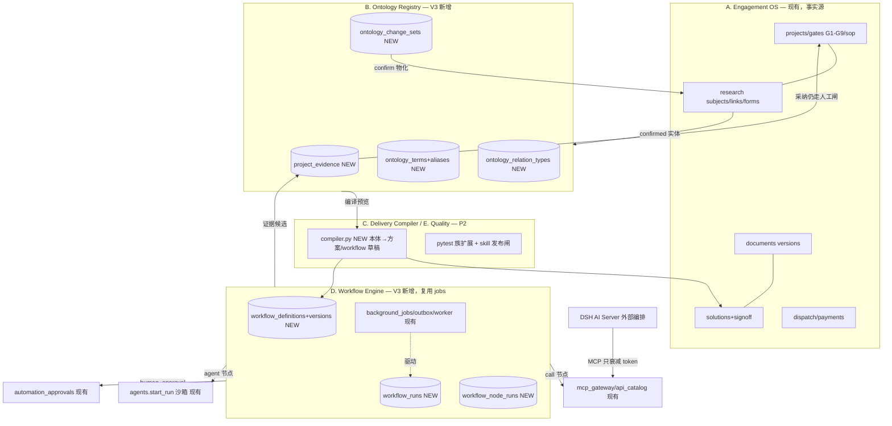

# 蔡工 FDE Workbench × fde-v2 架构融合审计与 V3 升级实施方案

- 版本：v1.0（2026-11-02）。审计执行：ZCode 审计子代理组（6 个专项）+ 主控复核。
- 基线：**Workbench @ `0570384`**（分支 fde-v2，96 业务表 / 269 路由 / 22 迁移 head `c3e7a9b1d5f4`）；**fde-v2 快照 ≈ 上游 master@`39e0e62`**（v2.3.0b0，本地无 git 历史，mtime 推定）。
- 结论口径：`VERIFIED` / `PARTIALLY VERIFIED` / `PROPOSED` 三态贯穿全文；新增设计全部 PROPOSED 并落到文件/表/接口。

---

## 1. 执行摘要

对两个仓库完成了真实代码审计（非文档推断）：Workbench 精读覆盖门禁/方案/文档/任务/控制平面/调研/本体六大域（6 份行号级证据报告，附录 A–F）；fde-v2 以零执行纪律完成流水线/本体/工作流/Agent/Skill/安全六线审计。自动抽取产出 385 行路由清单与 121 行表清单（脚本入库 `scripts/audit/`）。

**核心结论一（融合的真实价值边界）**：fde-v2 与 Workbench 不是同层系统。fde-v2 是"md 规格驱动、AI 代理施工"的**代码生成平台**（构建期九步法 + 运行期内省平台），其平台轨 groupbuild 代码在快照中缺失、无迁移系统、测试无 CI、存在 2 个高危洞（管理守卫失效 R1、SSRF R2）与 14 项可证据化风险；Workbench 是**交付管理系统**，在权限（每次调用实时鉴权/token 只衰减/审批一次性）、版本（alembic 22 链/不可变文档版本）、测试（pytest 1700+/vitest 730 实跑绿）三个维度全面占优。**因此 V3 不是"引入 fde-v2"，而是吸收其四件经过验证的思想**：①声明式 YAML DAG 形态（剔除其执行器全部可靠性缺陷）；②"候选→人工确认"的治理闭环形态（其 skills 审批闸与 Workbench guidance adopt 流同构）；③证据"出处+源块"粒度；④BR 三要素机器可读的质量纪律。

**核心结论二（Workbench 自身缺陷）**：审计发现 14 项 Workbench 现状缺陷（WB-DEF-1~14，全部行号证据），其中 **WB-DEF-1 signoff 死锁为功能阻断级**（agent_assisted 方案正常 completed 无 handoff → SOW 永久导不出 409），列 P0 立即修复。

**核心结论三（V3 蓝图）**：五层架构中 Engagement OS（现有）、Quality（部分现有）为 REUSE/EXTEND；Ontology Registry（术语/类型注册/变更集/一等证据 4+1 新表）、Workflow Engine（定义/版本/run/节点 3+1 新表，作为 background_jobs 新 job_type 不建第二套队列）、Delivery Compiler（纯函数编译预览）为受控新增。P0=证据一等表+本体最小闭环+死锁修复；P1=Workflow（call/skill 先行）+Skill 治理态+工具组+权限卫生；P2=证据候选接门禁+血缘补洞+编译器；P3=多 Agent 与自动执行（明确 DEFER）。

## 2. 审计范围与限制

**范围**：Workbench 服务端 24 模块 + 桌面端 + 迁移 + 测试（精读 ~90 文件，行号级）；fde-v2 全部平台模块 + 2 个应用组样例 + design-plus 规格 + 脚本（精读 ~60 文件）。
**限制（如实声明）**：
1. fde-v2 为不受信外部快照：**零执行**（未跑任何 verify 脚本，"是否全绿"= UNKNOWN）；快照与上游一致性仅 mtime 推定（本地无 git 对象）。
2. fde-v2 第三方依赖（agentscope 2.0.6 内部、lightrag 内部）无源码，相关结论标 UNKNOWN/PARTIALLY。
3. Workbench 运行时行为（SKIP LOCKED 并发、租约续期实测）为代码+测试断言推断，未做动态压测。
4. 生产库数据分布（如 gates.template_hash 存量）未查库。
5. DSH（AI Server）为外部黑盒，仅审接口契约侧。
6. 本轮**只审计与写文档**：未改业务代码、未跑迁移、未部署、未外呼（与任务书"先审计后实施"一致）。

## 3. 两个仓库的技术基线

详文：`docs/audit/v3-baseline-workbench.md`、`docs/audit/v3-baseline-fde-v2.md`。对照速览：

| 维度 | Workbench | fde-v2 |
|---|---|---|
| 形态 | Flask+SQLAlchemy API（Docker 4 服务）+ Electron 桌面端 | Flask+waitress 单体（compose 5 服务）+ 无构建 Alpine.js 前端 |
| 数据 | PG 16，96 表，alembic 22 链 | SQLite 默认（每应用一库）/PG 可选（静默回退），17 平台表，**无迁移系统** |
| 鉴权 | JWT+角色 rank+AI 五档+MCP 只衰减 token | Cookie 会话+RBAC 授权表；无鉴权模式全通 |
| Agent | DSH 外部编排+单 run 沙箱+L0-L3 降级 | AgentScope 进程内团队+flow 编排 |
| 工具面 | MCP 17+catalog 94（白名单制） | 内省全量 ~180+（开放制） |
| 测试 | pytest 1706 收集/CI 4 job | verify 脚本四层/无 CI/未执行 |
| 交付 | 门禁/方案/文档/派单/收款全链 | 无交付概念（应用即产物） |

## 4. 核心模块及调用链

（全部 VERIFIED，完整版见附录 C/D/F 的"关键调用链"节）六条主干：

1. **门禁**：`POST /projects/{id}/gates/{G}/evidence` → gate_service.submit_gate_evidence（FOR UPDATE）→ gates.evidence_checklist → `POST …/decision` → decide_gate 五道闸（拍板人≠执行人→G8/G9 admin→conditional 仅 G9→G8 必带 decision→accepted⊆claimed）→ operation_events；G8 pass→mark_acceptance_passed。全仓无第二写路径（grep 证实）。
2. **文档生成**：export_sow → [agent_assisted signoff 闸] → DocumentVersion(draft,sha256='') + GenerationJob + outbox('document.generate') → worker handle_document_generation → build_document_snapshot 冻结输入 → render_docx → 版本 sha256 落库 → outbox('file.preview')；幂等短路（sha256 非空/终态）。
3. **MCP 工具鉴权**：DSH → POST /internal/ai/mcp → _identity（15min JWT→重载用户→实时档∩claims）→ call_tool（注册表+capability）→ _project（claims+project_access）→ handler。
4. **审批**：DSH → /internal/dsh/executions/{run}/approvals → AutomationApproval(pending, sha256, 15min) → run=waiting_approval → 桌面 decision（人工+密码）→ execute_approved_dsh_tool（approved 态+sha256 复核+再鉴权+硬白名单）→ executed 一次。
5. **自动化调度**：flask scheduler → dispatch_due_automations（SKIP LOCKED+幂等键）→ run(queued)+outbox('automation.execute') → worker execute_automation_run（逐 capability 复查）→ dsh_runtime.execute（Idempotency-Key）→ 回调终态。
6. **调研→方案**：POST /ai/project-ai-opportunities/discover（读 confirmed 答案+备忘→DeepSeek→证据逐字校验→**只回建议不落库**）→ 人工 POST /research/subjects 落库 → guidance adopt/confirm 同构闭环。

fde-v2 侧四条（详见附录 A/B）：构建期九步法（文件树即状态）；`POST /api/apps/<app>/call/<svc>` → gate 授权 → FdePlatform.call（统一事务+sqlc AST 审计注入）；聊天工具链（AgentScope→bridge.execute 授权）；flow 执行（拓扑分层并行→flow_runs.db）。

## 5. 逐模块差距矩阵

**`docs/audit/v3-gap-matrix.md`**：17 能力域 × 17 字段全覆盖（每域含 Workbench/fde-v2 现状+证据、差距、REUSE/EXTEND/NEW/DEFER 裁决、目标文件、数据模型、接口、安全影响、实施任务、验收、优先级、依赖、可信度）。要点：REUSE 8 域、EXTEND 12 处、NEW 3 件（evidence/ontology 三表/workflow 三表）、DEFER 3 件（多 Agent 团队/RAG/规则推理）；高优先差距 5 项全部追到调用链级。

## 6. 数据库与接口映射

- **路由**：`docs/audit/v3-route-inventory.csv`（385 行 = WB 269 [url_map 枚举，33 蓝图，鉴权列分布：require_auth 213/require_role 31/require_minimum_role 8/bridge_token 1/开放 16] + fde-v2 116 [AST 装饰器]）。test_file 列启发式匹配 87/269 WB 路由有直接测试命中。
- **数据表**：`docs/audit/v3-database-inventory.csv`（121 行 = WB 96 表全字段[PK/FK/索引/版本字段/项目隔离/首建迁移 revision，96/96 有迁移归属] + fde-v2 25 处 DDL[17 真实+fixture 标注]）。
- **新增映射**：§14（表）与 §15（API）。

## 7. 目标架构与架构图

五层（任务书 §七 A–E 评估结论）：**A. Engagement OS**=现有 projects/gates/documents/solutions/dispatch/research（REUSE，唯一事实源）；**B. Ontology Registry**=NEW（terms/relation_types/change_sets）+EXTEND(research subjects/links)+evidence 底座；**C. Delivery Compiler**=NEW 纯函数（本体+模板→方案骨架/workflow 草稿）；**D. Workflow Engine**=NEW（definitions/runs/node_runs）挂在现有 jobs/outbox/worker 之上；**E. Quality & Evolution**=pytest 族扩展+发布闸+证据候选接门禁。

依赖方向（单向）：Registry←Engagement（读 confirmed）；Compiler←Registry；Workflow 只调既有闸（MCP/agents/approvals），不直写业务表（除证据候选）；Quality 横切。事务边界：change_set confirm=单事务逐项物化+事件；workflow 每节点独立事务先落表再前进（崩溃恢复锚点）；外副作用节点幂等键+不可恢复重投哲学（沿用 automation.execute）。错误恢复：workflow=节点级重试+paused 恢复+cancel；registry=base 指纹 409；文档=既有 sha256 短路。

## 8. Ontology Registry 设计

**`docs/architecture/ontology-registry-v1.md`**（P0）。决策要点：不建平行实体体系（subjects 就是实体）；ontology_packages/versions/entities/relations/evidence_links/review_decisions 六个候选表经查重**全部不建**（各有既有等价物），只建 terms+aliases/relation_types/change_sets 三件 + evidence 底座；AI 产物唯一入口=change_sets.proposed_json，confirm 前不物化（防"检索结果当业务事实"）；类型注册用 ∪ 语义不动存量 CheckConstraint。

## 9. Workflow DAG 设计

**`docs/architecture/workflow-dag-v1.md`**（P1）。决策要点：不复制队列——workflow 是 background_jobs 新 job_type；四类节点（call/skill/agent/human_approval，无 condition/wait——when+depends_on 已覆盖）；校验器纯函数先入 CI（环检测修 fde-v2 静默 done、call.ref 白名单封 SSRF、published skill 显式版本）；执行=每节点走既有闸（绝不旁路 api_execute/start_run/approvals）；fde-v2 执行器五项可靠性缺陷全部作为 V3 验收用例的反向锚。

## 10. Agent 权限与 Skill 生命周期

**`docs/architecture/agent-policy-v1.md`**（P1）。决策要点：五条权限原则现状全部 VERIFIED 保持（每调用实时鉴权/只衰减/写外副作用显式/审批绑定 sha256 目标/直连不绕过）；补强=ToolGroup（只收窄交集，种子文件零新表）+effect/risk 结构化元数据+审批卫生三件；Skill 以 WB 双表为底座扩 draft/in_review/published/deprecated+发布四闸（含测试报告或显式 waive）+回滚（版本行不可变故安全），**明确不采用** fde-v2 的 exec 装配角色、隐式页面授权、prompt 角色标记、user=None 全通、聊天-only HITL 五项机制。

## 11. G1–G9 集成方案（决策 4 落实）

- 职责铁三角维持并强化：**Workflow 执行产证据候选**（gate_evidence 标记→project_evidence→checklist 候选项 claim_status=None）；**Gate Service 唯一状态机**（submit/decide 唯一 HTTP 入口=真人会话，全仓无第二写路径已 VERIFIED）；**人工拍板**（五道闸不动；Agent 文字输出≠门禁通过——api_catalog 无 gates 条目且 grep 证实）。
- 新增仅"采纳"一步（人工点击把候选转正式证据提交，走既有 submit 闸）。
- 顺带修复：template_hash 漂移呈现（T-G2）；任务证据与清单脱钩（T-G1）。

## 12. Delivery Compiler 方案（P2，最小闭环）

输入=confirmed change_set + industry_template（published）+ gates 状态摘要；输出两类**草稿**：①方案骨架（复用既有 solutions /skeleton 纯模板路径，附 agent_trace 式来源标注）；②workflow 定义草稿（dag_json 模板化：调研→方案→审阅三节点）。纯函数（`workflows/compiler.py`）无副作用、可快照测试；落库一律走人工确认端点。**不做**全自动"本体→代码"（fde-v2 的构建期形态依赖外部代理施工，不适合 WB 服务端定位）。

## 13. 文件级改造清单（P0/P1 全量；PROPOSED 路径已标注）

| 动作 | 文件 | 任务 |
|---|---|---|
| NEW | server/src/fde_api/evidence/{__init__,models,service,routes}.py | T-E1 |
| NEW | server/src/fde_api/ontology/{__init__,models,service,routes}.py | T-O1~O3 |
| NEW | server/src/fde_api/workflows/{__init__,models,definition_service,executor,compiler,routes}.py | T-W1~W5/T-C1 |
| NEW | server/tests/test_{evidence,ontology,workflow_definition,workflow_executor,skill_lifecycle}_registry.py | 随任务 |
| NEW | server/seeds/tool_groups.json；desktop/src/renderer/src/{workflows/WorkflowConsole,ontology/GlossaryPage,extensions/SkillVersionsPage}.tsx | T-R1/T-UI1 |
| EXTEND | projects/gate_service.py、projects/task_service.py、solutions/service.py、agents/service.py、agents/tools.py、control/{models,extensions_service,builtin_skills,mcp_gateway,api_catalog,scheduler,service}.py、research/{subject_service,models,imports}.py、documents/{snapshots,ai_content,generator}.py、jobs/{outbox,worker,handlers,reconcile}.py、ai/{ai_server_client,ai_tool_loop}.py、bridge/sync.py、app.py（新蓝图） | 各任务 |
| 迁移 | server/migrations/versions/ 新增 4 个 revision（evidence；ontology×2；workflow×2；skill 扩列——按发布列车分批） | 各任务 |
| 不触碰 | workbench/models.py 既有列、guidance/translator 全链、bridge 投影语义、dispatch、meetings、DSH 客户端协议 | 兼容边界 |

## 14. 数据表和迁移设计

新增 8 表（全部 PROPOSED，结构全文见 ontology-registry-v1 §2 / workflow-dag-v1 §2）：`project_evidence`、`ontology_terms`、`ontology_term_aliases`、`ontology_relation_types`、`ontology_change_sets`、`workflow_definitions`、`workflow_definition_versions`、`workflow_runs`、`workflow_node_runs`（9 张）；扩列 2 处（skill_definitions/skill_versions 治理列）。通用约定：UUID PK、project_id 复合 FK CASCADE（项目隔离）、version 乐观锁、status CHECK、created/updated、reviewer/confirmed_by 审核列、content_sha256 指纹；**全部走 Alembic 单链新增+downgrade**，历史数据零改写（evidence_id 可空列/JSON 内新键向后兼容）。等价表查重结论见 §8（六个候选表不建的理由）。

## 15. API 契约

新增端点四组（全部 PROPOSED，完整 schema 见三份架构文档 §4-§5）：
1. 证据：POST/GET `/api/v1/projects/{id}/evidence`（can_manage/can_view；sha256 幂等）。
2. 本体：GET terms；POST/confirm/reject change-sets（can_manage+提交人≠确认人）；GET/POST relation-types（全局 admin）。
3. 工作流：POST workflows（draft）/publish（admin）/runs（422 dag_invalid 带）；GET runs 树；POST cancel。
4. Skill：submit-review/publish/rollback/versions（admin+密码确认）。
共同纪律：**不进 api_catalog**（AI 不可直接触达，同 signoff 先例）；错误码 400/403/404/409/422 语义与既有体系一致；幂等策略逐端点注明。

## 16. 测试、安全和验收标准

- 实跑基线（本轮真实执行，2026-11-02）：**服务端 pytest 1700 passed / 6 skipped / 0 failed（1706 收集，25:02，exit 0，与 d13 口径完全一致）**；**vitest 730/730 passed（60 文件，400.78s，exit 0）**；**operations 14/14 pass（0.78s，exit 0）**。详录与环境备注见 `docs/audit/v3-test-inventory.md`。fde-v2 verify 套件按零执行纪律未跑（原因已记录）。
- 验收体系：`docs/implementation/v3-test-plan.md`——本体 8 用例族（候选不自动发布/跨项目拒/confirmed 不可变/合并保留来源/证据历史/影响分析/类型注册/导入去重）、Workflow 10 用例族（环检测→固定版本）、权限安全 9 用例族（注入不扩权/撤销即时/审批不复用/日志不泄密/发布越权）、门禁交付物 5 用例族（Agent 文字≠门禁/快照血缘/迁移升降级）。
- 安全红线重申：证据只存指针+sha256；新表全 project_id 隔离；AI 不可写本体/门禁/发布端点；外副作用必审批且不可恢复重投。

## 17. 分阶段实施计划

| 阶段 | 内容 | 任务 | 出口判据 |
|---|---|---|---|
| P0 | 死锁修复 + 证据一等表 + 本体最小闭环（terms/types/change_sets+导入去重） | T-P0-1、T-E1~E3、T-O1~O4 | 死锁端到端绿；本体 8 用例族绿；全量 pytest/vitest 绿 |
| P1 | Workflow（call/skill 先行→agent/approval→cancel/resume）+Skill 治理+工具组+权限卫生+jobs 补强 | T-W1~W5、T-S1~S2、T-R1~R2、T-J1~J2、T-P1-4/5、T-OBS1 | Workflow 10 用例族绿；skill 发布闸上 CI；4 CI job 绿 |
| P2 | 证据候选接门禁 + 文档血缘补洞 + Compiler 最小闭环 + 影响分析 + 桌面三页 | T-G1~G2、T-D1、T-C1、T-I1、T-UI1 | 门禁候选端到端；版本行可反查 ai_call/revision；打包 asar 验证过 |
| P3 | 多 Agent 自适应/Skill 进化/规则推理/有限自动执行 | 立项不排期 | P0–P2 安全可靠性验收全绿后评估 |

节奏：纳入既有 goal-d 循环逐任务交付（每任务独立 PR→CI 4 绿→合并→ff main→更新本报告状态列）；不并行开第二实施线。

## 18. 风险与回滚策略

**`docs/audit/v3-risk-register.md`**：WB 现状缺陷 14 项（1 高 4 中 9 低，全部行号证据）、fde-v2 教训 11 项（不构成 WB 现网风险，仅防重蹈）、V3 实施风险 8 项（含 workflow 资源面、Registry 双轨分裂、迁移兼容、越权回归、双轨证据不一致）。回滚策略：全部新表 alembic downgrade 安全（零外键反依赖）；每个任务单 commit revert；种子文件无状态；桌面页独立路由可整体隐藏；发布火车任意站点可止步（各阶段出口判据独立）。

## 19. 不建议照搬的 fde-v2 设计（7 项，均有代码证据）

1. **flow.py 执行器**：环静默 done、无重试/恢复/取消/幂等、call 越权不中止、绕 HITL（附录 B 2-6）——只搬 YAML 形态与节点三分法。
2. **运行时 DDL reconcile + SQLite 静默回退 PG**：与迁移纪律冲突（附录 E 2-3）。
3. **隐式页面授权（X-Fde-Page 派生服务放行）**：前端声明=权限扩大（附录 E 4）。
4. **exec 装配 _roles.py + system_prompt 角色标记**：任意代码执行面与提示即权限（附录 B 7）。
5. **无鉴权模式 user=None 全通 + stdio MCP 缺省全通**：fail-open 部署面（附录 E R5'/R9'）。
6. **内省全量工具面（~180 服务直暴露）**：WB 白名单制（17+94）在攻击面上量级更优（附录 B/E 对照）。
7. **agentscope 进程内多 Agent 团队**：引入第二运行时+内网服务面，DSH 已承担编排（附录 B 9 vs C 6）。
另：LightRAG 知识图谱层其自身定位即"检索层非治理层"（本体对象.md 自认非本体），WB 无消费方前不引入（P3 评估）。

## 20. 最终决策与下一步行动

**决策**（对应任务书六大决策）：①本体分层裁定=文档/候选/正式/规则/事实五层各归其位，RAG 不建；②最小模型=3 新表+底座（6 候选表查重不建）；③Workflow=jobs 新 job_type 不复制队列，与 automation 三表职责边界=触发器/DSH 会话 vs 编排/节点；④G 门禁铁三角不动，workflow 只产证据候选；⑤权限五原则保持+三补强，fde-v2 五机制明确不用；⑥Skill=WB 双表扩治理态不另建。

**下一步 3 件事**（建议顺序）：
1. **T-P0-1 signoff 死锁修复**（S，独立 PR，先红后绿端到端用例）——现网功能阻断，收益立现。**→ 已完成（2026-11-02，fix/v3-t-p0-1-signoff-deadlock；实现偏差——统一开闸模块 `agents/signoff.py`、L1 排除、export 兜底开闸先提交再 409、`remedy=resolve_pending_signoff`——已回写 backlog T-P0-1「实施记录」）**
2. **T-E1 一等证据表 + T-E2 门禁挂接**（M）——全部 V3 数据治理的地基，且立即改善门禁证据审计（历史指针不再覆写）。**→ 已完成（2026-11-02，fix/v3-t-e1-e2-evidence；偏差——POST 201/200 按 created、referenced_by 仅 gate:Gx、新事件 evidence_registered、延迟导入——见 backlog T-E1/T-E2 实施记录）**
3. **T-W1 DAG 校验器（纯函数）先行入 CI**（M）——零执行器依赖即可锁定定义质量，为 P1 铺路且无运行时风险。**→ 已完成（2026-11-02，feat/v3-t-w1-workflow-definitions；两表 + 纯函数 1–8 阻断 / 9 告警；零路由——偏差见 backlog T-W1 实施记录）**
4. **T-W2 runs/node_runs 两表**（S）——执行器的地基，纯增量。**→ 已完成（2026-11-03，feat/v3-t-w2-workflow-runs；迁移 `b7d9f1a3c5e2`，run 幂等键全局唯一修 FV-F3、definition RESTRICT / project CASCADE、节点 depends_on 冗余快照——见 backlog T-W2 实施记录）**
5. **T-W3 执行器（call+skill 节点）+ §5 路由**（M）——Workflow 线业务价值的第一块闭环。**→ 已完成（2026-11-03，feat/v3-t-w3-workflow-executor；`workflow.run` handler 复用 jobs 全套、节点独立事务、call=api_execute 同闸+写类节点同构幂等键、skill=pinned 版本确定性 AI 调用、§5 五条路由（cancel/resume HTTP 随 T-W5）、agent/human_approval start_run 即 422 随 T-W4；skill published 语义按 T-W1 先例待 T-S1 收敛——偏差见 backlog T-W3 实施记录；下一步 T-W4 / T-W5 或 T-S1）**
6. **T-W4 执行器 agent/human_approval 节点**（M）——四类节点闭环；human_approval 复用 automation_approvals（迁移 `d5b8e2f4a7c9`：run_id 可空 + workflow_node_run_id 反链），拍板走既有任务中心零新路由，agent 走 agents.start_run 同闸（attempt 代际幂等键）。**→ 已完成（2026-11-03，feat/v3-t-w4-agent-approval-nodes；偏差——审批反链 FK CASCADE/迟到拍板中和/attempt 代际幂等/分派失败不叠加重试/capability 白名单=登记表去 system.*——见 backlog T-W4 实施记录；下一步 T-W5 / T-S1 / T-E3 / T-O1）**

---

### 附：交付物清单（全部实际落盘）

| 文件 | 状态 |
|---|---|
| docs/architecture/蔡工FDE_Workbench_fde-v2架构融合审计与V3升级实施方案.md（本文） | ✅ |
| docs/audit/v3-baseline-workbench.md / v3-baseline-fde-v2.md | ✅ |
| docs/audit/v3-workbench-module-inventory.md / v3-fde-v2-module-inventory.md | ✅ |
| docs/audit/v3-route-inventory.csv（385 行，含 fde-v2 116）+ 分仓 csv | ✅ |
| docs/audit/v3-database-inventory.csv（121 行）+ 分仓 csv | ✅ |
| docs/audit/v3-test-inventory.md | ✅（pytest 1700+6s / vitest 730 / ops 14 实跑终录已回填） |
| docs/audit/v3-gap-matrix.md（17 域）/ v3-risk-register.md | ✅ |
| docs/audit/appendix/{A–F 六份行号级原始审计报告} | ✅ |
| docs/architecture/ontology-registry-v1.md / workflow-dag-v1.md / agent-policy-v1.md | ✅ |
| docs/implementation/v3-backlog.md（24 任务）/ v3-test-plan.md（四族用例） | ✅ |
| scripts/audit/extract_{workbench,fde_v2}_inventory.py（可复现抽取） | ✅ |
