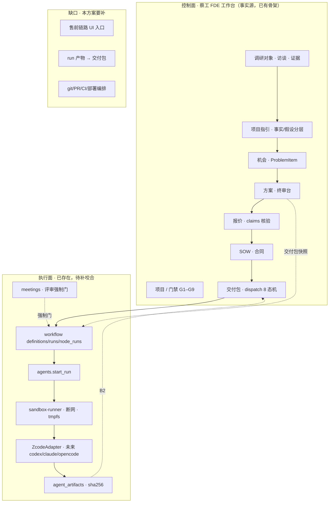

# 售前驱动交付模式改造方案（v1.0）

> 版本：v1.1 ｜ 日期：2026-11-06 ｜ 议题：把蔡工 FDE 工作台从「业务项目与文档工作台」升级为「售前驱动的智能交付平台」
> 来源：2026-11-06 与用户的商业模式讨论（售前访谈 → AI 诊断 → 对症方案 → 签约 → 智能体交付）
> 证据口径：本文所有「现状」主张均以 2026-11-06 仓库代码实测为准（文件:行号）；**原始对话中的现状描述有若干已过时之处，本文逐条校正（见 §2）**。
> 状态口径：现状部分 **VERIFIED**；目标架构与新增能力 **PROPOSED**；商业判断 **CLAIM（待拍板）**。
> **v1.1 变更（2026-11-06）**：Q1–Q7 七项决策已由用户交互式拍板完成，§10 由「待拍板清单」改写为「决策台账」，§7 实施顺序按决策修订。

---

## 0. 结论先行

**可以改造，且方向成立。但产品定位不能停在「会调用编码智能体的工作台」，而应是：**

> **以业务证据、方案、报价和门禁为核心，以编码智能体为执行器，以人类 FDE 为责任主体的智能交付平台。**

三点必须先说清楚：

1. **原对话的「现状盘点」大面积过时。** 编程执行层（沙箱、`ZcodeAdapter`、`agent_artifacts`、workflow agent 节点、评审会 `meetings`）**已经全部落地**。真正的缺口不是「接一个编码 CLI」，而是**售前链路本身**（访谈 → 事实/假设分层 → 机会 → 方案 → 报价 → SOW）的桌面入口与合同闭环，以及**执行层与业务层的咬合**（run 产物如何变成可签约的交付包）。
2. **可以替代大量重复性工作和标准化编码，不可以取消工程师的责任主体。** 编码智能体能干活，但不能对客户结果、法律责任和生产事故负责。门禁的人工拍板权不可让渡。
3. **最该先做的不是接第三个编码智能体，而是打通「访谈 → SOW」。** 这条链打通后，即便不接任何编码智能体，也能大幅降低售前对工程师的占用——投入产出比最高、风险最低。

---

## 1. 商业模式主张（CLAIM，待拍板）

用户主张的核心命题：

> 让经过短期基础培训的 FDE 业务代表做售前（访谈 + 调研），资料输入工作台由 AI 梳理出问题并给出对症解决方案，方案直接用于谈签约合同；这样就不用养太多 FDE 工程师，只需多养「懂一点 FDE 的售前」，大部分交付由蔡工 FDE 工作台（编码智能体）承担，或售前与工作台协作交付。

**本方案对这一主张的裁决：方向成立，但需要三处修正。**

| # | 原始主张 | 裁决 | 修正要点 |
|---|---|---|---|
| 1 | 「工作台需要变成编程智能体/编程工作台才能承担大部分交付」 | **部分不成立** | 工作台的编程执行层**已经存在**（`agents/` + `sandbox-runner` + `workflows` agent 节点）。缺的不是编程能力，是**售前到签约的证据链**和**执行产物到交付包的闭环**。把它当「编程工作台」是定位误判，会把已有的交付管理系统当成执行器来重造。 |
| 2 | 「大部分交付可通过工作台交付」 | **成立，但需能力分层** | 标准化程度高的部分（部署脚本、前端脚手架、文档、迁移草稿、重复性分析）可由智能体主导；涉及生产数据、复杂硬件、强监管、客户组织问题的部分必须人类主导。已有 `dispatch.agent_assisted_declare` 正是表达这种「接单人声明采用智能体协同」的既有机制。 |
| 3 | 「不用养太多 FDE 工程师，只需多养售前」 | **方向成立，但表述要改** | 有价值的转型不是「少养工程师、多养销售」，而是：**多养懂客户、懂 FDE 流程、能组织证据和验收的售前；少养大量重复编码、查资料、写文档、做基础测试的工程师；保留少量高能力专家。** 工程师从「施工者」变成「监理与验收者」。 |

---

## 2. 现状校正（VERIFIED，代码实测）

原始对话的「现有工作台已经具备哪些基础」一节大体正确；**「现在缺的不是接一个编码 CLI，而是编程执行层」一节则严重过时**。逐条校正：

### 2.1 已被推翻的说法

| 原对话说法 | 实测结论 | 证据 |
|---|---|---|
| 「没有暴露通用的『创建并启动一次编码智能体运行』接口」 | **不成立**。已有完整 run 接口族 | `server/src/fde_api/agents/routes.py:42`（POST `/<agent_id>/run`）、`:53`（run 详情）、`:60`（handoff）、`:67`（retry）、`:75`（tool-calls）、`:84`（cost）、`:97`（fallback-rehearsal）、`:104`（recover）、`:111`（pilot-report）、`:118`（quota） |
| 「尚未看到仓库克隆、Git 分支和 worktree 管理」 | **不成立**。openfde 侧已有完整 worktree 生命周期；工作台侧沙箱已实现 | `openfde worktree list/open/remove`；工作台沙箱 `server/src/fde_api/agents/sandbox.py:218`（create）、`:287`（exec_argv）、`:306`（exec） |
| 「没有隔离代码执行环境」 | **不成立**。`sandbox-runner` 服务已存在 | `compose.yaml:130-155`：`privileged: false`、`network_mode: none`、`tmpfs: /workspace:size=512m`、`profiles: [sandbox]`（默认不启动，试点 gate 才开） |
| 「插件机制并不是天然的任意 Shell 执行器」 | **成立且正确**——这是好设计，应保留 | `agents/sandbox.py:57` egress 默认 deny（`--network none`）；`:266` `--network` 参数化 |
| 「当前 AI Server 运行时还需要启用和配置」 | **部分过时**。DSH 运行时已有 enabled/runtime_version 抽象与健康回报 | `server/src/fde_api/control/dsh_runtime.py:36,45-53`；`control/mcp_gateway.py:217` 回报 `ai_server_enabled` / `runtime_version`。**但** DSH 是否真在本机环境启用属运行态，文档不作断言 |

### 2.2 已核实成立的能力（原对话说对了，且比说的更完整）

| 能力 | 实测位置 |
|---|---|
| 事实/假设/待确认的**分层**已内建 | `server/src/fde_api/guidance/ai_schema.py:6` `CLASSIFICATIONS = {customer_stated, ai_synthesized, ai_inferred, open_question, human_added}`；`:60` evidence 引用必须命中 `source_refs`，否则 `unknown_source_ref` 拒收 |
| ProblemItem 的可签约优先级与模块映射 | `ai_schema.py:18-20`：`SEVERITIES = (high, medium, low)`、`ITEM_OPTIONAL_KEYS = {severity, module}`（仅对 `key_business_problems` 放开，其余 10 字段维持精确键集防漂移） |
| 方案 → SOW 冻结导出，AI 不二次改写 | `api_catalog.py:61`「将已保存方案版本导出 SOW，内容保持原样，不重新 AI 推演」；`solutions/service.py:669` `export_sow` 强制传 `version` |
| agent 协同方案的 SOW 终审闸（防 AI 协同绕过人工） | `solutions/service.py:673-684`：agent_assisted 包绑定的方案，导出 SOW 前必须终审台拍板通过，「未 approved 的 AI 协同方案一个字节都不出系统」；闸独立成事务，拦下时兜底开闸先提交再抛 409（T-P0-1 死锁修复） |
| 报价的档位/系数/锚点/claims 核验链 | `server/src/fde_api/projects/quote_service.py`：`:137` B 层系数 = 0.9 + 总分×0.03；`:226` `_advance_claims` 逐字段推进 estimated→claimed；`:581` finalize；`:861` `claims_summary`（accepted/total） |
| 报价核验与 SOW 分离 | `api_catalog.py:79` `dispatch.packages_create` 需 `solution_id + quote_id` 建交付包 |
| 智能体运行与人工接管 | `agents/service.py:664` `start_run` / `:882` `handoff_run`（L3 转人工）/ `:927` `retry_run`（幂等）/ `:1023` `rehearse_fallback`（降级演练）/ `:1077` `recover_run` |
| 产物落库与指纹 | `agents/models.py:127` `AgentArtifact`；`:146` `AgentToolCall`（含 denied 留痕） |
| 智能体协同声明（接单人主动声明） | `api_catalog.py:118` `dispatch.agent_assisted_declare`：声明后才启用 T1–T6 评审门与溯源联动，难度 high 禁声明，8 态机零改动 |
| 能力档位实时重判 | `server/src/fde_api/control/access.py:72-75`：`agent.plan.generate`≤project_operator / `agent.code.write`≤project_manager / `agent.meeting.convene`≤project_operator / `agent.system.tool`=system_operator |
| 四类工作流节点全落地 | `server/src/fde_api/workflows/executor.py:78` `SUPPORTED_NODE_TYPES = ("call", "skill", "agent", "human_approval")`；agent 节点走 `agents.service.start_run` 同闸全链（`:912`、`:1027`），幂等键 `wfnode-{行id}:{attempt}` |
| 评审会与强制门 | `server/src/fde_api/meetings/routes.py:35-88`：创建/详情/插话/关闭/纪要/模板/清单/暂停共 8 条；`meetings/service.py:436` 调 `authorize_ai_capability(user=actor, capability="agent.meeting.convene", project=project)` |
| 脱敏上下文渲染（进沙箱的唯一输入） | `agents/service.py:332` `_render_context`：只写代号 + 已确认 ProblemItem + 方案骨架 + 知识片段，禁区词/非法条目 **fail-closed 422**，绝不 500 裸抛；`:363` `_write_workspace` 写红线三文件（context.md / 任务书 / AGENTS.md 纪律） |
| 门禁人工拍板不收进 AI 工具面 | `api_catalog.py:121-136`：人工拍板类路径永不收编；`CONFIRMATION_KEYS = {solutions.export_sow, documents.generate}` |

### 2.3 真实缺口（这才是该投钱的地方）

| # | 缺口 | 证据 |
|---|---|---|
| G1 | **售前链路的桌面入口不全**。调研表三态流转（confirm/reject/revise）无 UI 入口，是「调研 → 方案」链路的真实断点 | `docs/后续需求台账-F5与D11.md` §一 第 1-3 条：三个端点 desktop 0 引用，服务端状态机已完整 |
| G2 | **预调研录入卡的 S3 前置闸未见落地**。方案设计了「SOW-A signed + A 款到账 + 授权书四项勾选」的系统闸，但 presurvey 路由只有 source/list/create/detail/patch/revision/confirm/intake 八条，**未见独立的 S3 前置检查接口** | `server/src/fde_api/guidance/routes.py:22-96`；设计方案 `docs/技术实施方案-智能体交付工作台.md` §1 S0-1 |
| G3 | **录音转写链缺失**。`ai/kimi.py` 与 `control/chat.py` 里的 "transcript" 均指对话转录文本，不是音频转写。访谈录音→文字这条链在代码中不存在 | `grep -rln "transcri\|audio\|录音" server/src` 仅命中这两处且语义不符 |
| G4 | **服务端无 git/worktree/PR/CI/部署编排**。`grep -rln "worktree\|git " server/src` 零命中；PR/部署/回滚无对应服务层 | 同上（`worktree`/`git` 在 `server/src` 无命中） |
| G5 | **AI Server / DSH 运行态未确认**。健康接口回报 `ai_server_enabled`/`runtime_version`，但本机是否真的启用未实测 | `control/mcp_gateway.py:217` |
| G6 | **agents/meetings 缺桌面控制台**。桌面端仅有 `pilot/PilotReportPage.tsx` 与 `solutions/QuotaMeter.tsx` 引用 agents，**没有 run 列表、run 详情、tool-calls、tool-calls 详情、cost、meetings 的完整 UI** | `desktop/src/renderer/src/` 目录清单：`pilot/`、`guidance/`、`solutions/`、`workflows/` 存在；无 `agents/`、无 `meetings/` |
| G7 | **执行产物 → 交付包 的闭环未打通**。`agent_artifacts` 有 sha256，但与 `delivery_package`（D11 设计草案）未关联 | `docs/后续需求台账-F5与D11.md` §二 交付包设计草案；`agents/models.py:127` |
| G8 | **S2 红线与本方案冲突点**：既有约束「不录音转写入库」直接决定了 G3 的实现方式（转写结果不能进正式库），实现前必须先拍板 | `openfde fde -e somwyn` 的 Never violate 段：「S2 红线（录音不可存）」 |

---

## 3. 目标架构：控制面 + 执行面（PROPOSED）

原对话的「工作台做控制塔，编码智能体做施工队，人类专家做监理和验收」这个比喻是对的，本方案沿用并把它落到已有的实体上。



### 3.1 为什么不让 AI 直接出合同（红线，不可让渡）

- **AI 可以填、可以查、可以给建议；AI 不能改法律条款，不能代替人拍板。** 这与仓库既有纪律一致：门禁三条路由（提交证据 / 人工核验）**有意不进 api_catalog**（`docs/后续需求台账-F5与D11.md` §三），AI 不代执行、更不代拍板。
- **报价 claims 未核验、实际工时与成交价未回填时，不能直接拿来签合同。** 这是既有实现纪律（`quote_service.py` 的 `_advance_claims` / `finalize_quote`），不是新增约束。
- **SOW ≠ 完整合同。** 正式签约还应包含经法务批准的：保密协议、数据处理条款、客户配合义务、验收窗口、付款条件、知识产权、第三方软件与开源许可、变更管理、售后与支持、责任边界。AI 可以做**检查清单与缺项提示**，不能自行改写这些条款。

---

## 4. 七阶段 SOP（PROPOSED，含与现有能力的映射）

| 阶段 | 目标 | 现有能力 | 缺口 | 谁负责 |
|---|---|---|---|---|
| S1 售前准备 | 项目立项、选行业模板与首期模块、拿到访谈提纲与风险提示 | `guidance` presurvey source/intake | 提纲模板化（G6 附近） | 售前 |
| S2 访谈与采集 | 录入客户原话、现状流程、问题证据、已有数据系统、业务目标与限制 | `research` subjects/links/forms、`guidance` 上传与提炼 | **录音转写（G3）、事实/假设分层的 UI 表达（G1）** | 售前 |
| S3 诊断与机会 | 提取核心问题、根因、影响角色与流程、基线数字、业务价值、前置条件、待确认项 | `ai_schema.py` 五分类 + `source_refs` 强制 + `severity`/`module` | 机会落库前的人工核验 UI（G1） | 售前 + 方案负责人 |
| S4 方案设计 | 问题陈述 / 基线 / 目标态 / 三选项与取舍 / 推荐 / 交付物 / 明确不做 / 验收标准 / 数据依赖 / 里程碑 / 风险 / 客户需提供的资源 | `solutions.skeleton`（模板草稿）、`solutions.organize`（AI 建议不落库）、`solutions.health`（模板覆盖率/引用完整性/报价合法评分） | 终审台 UI 已有（`solutions/SignoffConsole.tsx`），需接三选项与取舍 | 方案负责人 |
| S5 报价与签约 | 档位/系数/锚点/工时/建议价/收款计划程序化计算 | `quote_service` 全套 + claims 核验 + `render_quote_draft` | **合同模板与法务条款清单（新建，非 AI 职责）** | 售前 + 负责人 |
| S6 交付编排 | 签署后拆任务包：目标、范围/非目标、验收标准、方案与证据快照、仓库与环境、测试命令、安全限制、预算与截止 | `workflows` 定义/校验/执行、`dispatch` 8 态机 + `agent_assisted_declare` | **git/PR/CI/部署编排（G4）、任务包与方案快照的绑定** | 编排中枢 + FDE |
| S7 评审验收归档 | run 产物 → diff/测试/制品/风险/成本 → CI → 人工代码审查 → 客户演示 → 人工验收 → 产物登记 → 门禁证据提交 → 人工核验 accepted | `agent_artifacts` + `meetings` 强制门 + `gates` 证据链 + T-G1/T-W7 证据候选 | **run 产物 → 交付包（G7）、agents/meetings 桌面控制台（G6）** | 人类 FDE（不可让渡） |

### 4.1 三种交付模式（按风险分流）

| 模式 | 触发条件 | 智能体职责 | 人类职责 |
|---|---|---|---|
| **平台主导** | 标准化程度高（部署脚本、前端脚手架、文档类） | 编码、测试、文档 | 抽查 |
| **智能体 + 人类专家** | 有集成复杂度但可控 | 编码、初版测试 | 架构、代码审查、客户集成、上线 |
| **人类主导** | 生产数据 / 复杂硬件 / 强监管 / 客户组织问题 | 只做分析与文档辅助 | 全程主导；工作台只负责协调与留痕 |

选择权在接单人手上——`dispatch.agent_assisted_declare` 就是这个开关（难度 high 禁声明，声明后才启用 T1–T6 评审门与溯源联动）。

### 4.2 每次 run 必须返回的结构（PROPOSED，补齐现有 Artifact 字段）

```
branch / commit · changed_files · diff · test_results · build_results
lint / security_scan · known_risks · artifact_references · logs
token / duration / cost · sha256
```

**现状差距**：现有 `agent_artifacts` 有 sha256，但**没有 diff 与 test_results 的结构化落库字段**；`AgentToolCall` 记 denied 但不记测试结论。这是 G7 的一部分。

---

## 5. 编码智能体接入规范（PROPOSED）

### 5.1 统一适配器协议

业务工作台只认识「编码智能体」，不绑定厂商。现有 `ZcodeAdapter`（`agents/adapter.py:105-108`，`kind = "zcode"`）已经走对了方向——**扩展它，而不是另起一套**。

```
prepare_workspace · validate_request · run · collect_result · cancel · health_check
```

统一输出：`status / summary / changed_files / commit+diff / test_results / artifact_references / known_risks / cost / logs / sha256`

### 5.2 接入三家前必须逐项确认（zcode 尤其）

| 必答项 | 为什么 |
|---|---|
| 是否有稳定 API 或 CLI（非交互） | 只有人工交互界面的工具**不适合**作为工作台执行器 |
| 能否指定工作目录与模型 | 否则沙箱隔离形同虚设 |
| 能否返回结构化结果 | 否则产物只能靠扫目录猜，与 `agent_artifacts` 的 sha256 链断裂 |
| 是否有会话恢复与取消机制 | 沙箱有超时与心跳 kill，CLI 没有恢复就是半拉子 |
| 凭据如何托管 | 现纪律：`agent_credentials` Fernet 加密，**仅经 `docker exec -e` 注入容器进程**，宿主 shell 历史/日志不落明文，run 结束凭据随容器销毁 |
| 是否允许商用与多租户隔离 | 商用责任落在主体公司 |
| 版本如何钉死 | 已有先例：`docs/试点前联调-iptables与zcodeCLI-检查单.md` 要求钉死 zcode CLI 版本 + 二进制 sha256，防供应链漂移 |

### 5.3 执行隔离红线（既有纪律，照抄执行）

- 每次 run 独立容器 / 独立 worktree；**只挂 workspace**（`sandbox.py` 单 bind mount 纪律）
- 默认 `--network none`；需要外网走 per-run 网络 + iptables 白名单（`sandbox.py:57`、`:143`、`:266`）
- **绝不挂真相层**（`D:\test\FDE\…`）、`.env`、任何密钥文件
- 凭据经 Secret Broker 临时注入，run 结束销毁
- 禁止默认访问生产数据库 / 默认部署生产 / 直接推送主分支
- 安装依赖、访问外网、部署 → 人工审批（`automation_approvals` 既有闸：`(run_id, request_key)` 唯一 + `arguments_sha256` + 15min + 一次性 + 执行前再鉴权）

### 5.4 不要让供应商侵入主 API

现有架构的纪律是对的：API 创建 run → 队列调度 → 隔离 Runner 执行 → 收集产物 → 持久化 run/tool_calls/cost/指纹 → 人工评审。**不要在工作台后端进程中直接执行任意命令行。**

---

## 6. 人员结构与能力分层（PROPOSED）

| 角色 | 核心职责 | 能否被智能体替代 |
|---|---|---|
| FDE 售前代表 | 访谈、建立信任、录入事实、确认需求、讲解方案 | 部分（记录可自动化，关系与判断不可） |
| 解决方案负责人 | 审方案、技术可行性、范围与风险把关 | 否 |
| 编码智能体 | 编码、测试、文档、迁移草稿、重复性分析 | 就是它本身 |
| 现场/专业 FDE | 客户现场、数据接入、硬件、复杂集成、生产问题 | 否 |
| 管理员与质量负责人 | 权限、模型、插件、审计、抽检和指标 | 否 |

**能力等级（建议用平台机制硬约束，而不是口头承诺）**：访谈助理级 → 独立售前级 → 方案审核级 → 交付专家级。可用**必填项、问卷完整度、AI 补问、历史质量数据**控制售前代表能推进到哪一步。

> ⚠️ **落地前必须查清一个数据边界**：`guidance` 的上传入口是否允许售前代表上传含客户真实名称的文件。AGENTS.md 红线：「客户真实资料永不进 git 历史与远端：仓库和数据库只存代号（如 somwyn）」，且 somwyn 的 Never violate 里有「代号化红线」与「raw/ 只增不改」。**这条直接决定「售前上传访谈资料」这条路能不能走通、怎么走。** 本文档不臆断其现状，列为待拍板项 Q1。

---

## 7. 实施顺序（按投入产出比排序，不按技术酷炫度）

### 第一阶段：打通「访谈 → SOW」（不接任何编码智能体）

**这一阶段独立产生价值，且是所有后续阶段的前置。**

1. 补调研表三态流转的 UI 入口（confirm/reject/revise）——**这是链路断点，最高优先**
2. 事实/假设/待确认的三层在桌面端可见可编辑（客户原话 vs AI 推断必须视觉可分）
3. presurvey 的 S3 前置闸落地（SOW-A signed + A 款到账 + 授权书四项勾选）
4. 方案三选项 + 取舍 + 明确不做 + 验收标准 的骨架模板
5. 报价 claims 核验 → 冻结 SOW 的 UI 闭环
6. 客户谈判版本管理（方案版本快照不可变，谈判稿与最终 SOW 分离）

**出口指标**：一个真实客户项目能从访谈走到合格方案 + 冻结 SOW，每一步都有来源、版本、责任人和证据。

### 第二阶段：补执行层的桌面控制台（G6）

agents run 列表/详情/tool-calls/cost + meetings 会议与纪要 + workflow 控制台（已有 `WorkflowConsole.tsx`）三者打通成「一个交付看板」。

理由：执行面已存在但**看不见**。人看不见的自动化等于没有自动化——尤其对「售前 + 少量专家」的新团队形态。

### 第三阶段：run 产物 → 交付包（G7）+ git/PR/CI 编排（G4）

- `agent_artifacts` 增加 diff / test_results 结构化字段
- 产物指纹接入 `delivery_package` 封包（`docs/后续需求台账-F5与D11.md` §二 草案：`manifest_sha256` + 逐项 sha256 校验）
- git worktree / PR / CI 编排层（可考虑直接复用 openfde `worktree` + `run` 的成熟实现，而不是在 Flask 侧重造）

### 第四阶段：接第二个编码智能体

**先做完一个供应商的端到端闭环，再抽象第二个。** 选择标准：企业支持完善、非交互调用稳定、权限与数据条款可控、成本可追踪、能返回代码/测试/日志。

### 第五阶段：生产交付与持续改进

CI/CD、部署审批、回滚、运行监控、线上问题反馈、交付物模板化、Skill 化、插件市场。

---

## 8. 成功度量（不要只看「生成了多少代码」）

| 类别 | 指标 |
|---|---|
| 售前效率 | 访谈 → 合格机会所需时间；方案从访谈到 SOW 的时间 |
| 门禁质量 | G1/G2/G3 一次通过率；人工返工率 |
| 人力结构 | **每个项目占用的工程师小时数**（这是「少养工程师」主张的直接验证指标） |
| 复用 | 标准交付物复用率；标准方案骨架复用率 |
| 执行质量 | 编码智能体任务一次测试通过率；智能体产物被人工接受率 |
| 经济性 | 每个客户验收项目的智能体成本；**交付毛利率** |
| 客户面 | 客户现场问题数量；G8 验收一次通过率 |

**最重要的验收条件（建议作为整轮改造的北极星）：**

> 一个真实客户项目能够从访谈走到 SOW、交付、验收和归档；每一步都有来源、版本、责任人和证据；**智能体不能越权修改、不能部署、不能自动过门**。

---

## 9. 红线清单（违反即事故）

沿用仓库既有红线，本方案新增 4 条：

1. **AI 不代拍板**：门禁提交证据与人工核验继续不进 api_catalog；智能体不得自动把 claimed 变 accepted。
2. **AI 不出法律条款**：AI 可填可查可提示缺失项，不得改写合同条款；SOW 导出必须绑定已冻结的方案版本。
3. **执行面不可触真相层**：沙箱不挂 `D:\test\FDE\…`、不挂 `.env`；脱敏渲染 fail-closed；上下文渲染产物须通过真实客户名/盘符路径零命中断言（CI 已有 gitleaks，需再加一条脱敏断言）。
4. **售前代表不得代客户拍板业务结论**：售前录入的事实需客户确认；AI 推断与客户原话必须分层且可溯源。

---

## 10. 决策台账 Q1–Q7（2026-11-06 用户拍板）

> 七项全部已决（用户交互式拍板）。本节记录**决策内容 + 依据 + 落地约束**，替代原「待拍板清单」。
> 状态：**DECIDED**（用户 2026-11-06 拍板）。实现偏差须回写本节。

### Q1 代号化边界 —— 入库时自动替换为代号 ✅

**决策**：售前上传访谈资料时，服务端在入库前把正文中的真实企业名替换为代号（如「客户A」），原文留在本地 raw/ 不入库。

**依据**：
- `scripts/check-pseudonymization.sh` 只扫**数据库 dump**（`pg_dump --data-only --inserts`，`:104`），**不扫文件二进制内容** ⇒ 上传文件正文含真实企业名时 CI 门禁**静默通过**。替换必须在入库时做才可靠。
- `guidance/redaction.py:22` 的 `redact_text` 已在做手机号/邮箱/证件号脱敏，但**故意不脱企业名**（企业名不是 PII 格式）⇒ 企业名需单独一层。
- `projects.enterprise_code` 已是三段式代号（`client·industry·city`，格式检查见 `check-pseudonymization.sh:206`），替换目标可直接对齐。

**落地约束**：企业名词典来源 = `leads.md` 黑名单（`:91` 的中文 2–15 字 + 公司/集团/厂 结尾正则，已用于 CI 扫库）⇒ **同一份词典双向复用**：CI 用它扫库，入库替换用它做替换。替换发生在 `redact_text` 之后、落库之前；原文由售前自行留存于本地 raw/（遵循 somwyn「raw/ 只增不改」纪律）。

### Q2 录音转写 —— 录音不存，转写文字可入库 ✅

**决策**：音频文件仅在本地临时留存并转写；**转写出的文字按「企业主动发来的文字」同等对待入库**。

**依据**：
- S2 红线原文是「不录音转写入库」，红线针对**录音**本身；转写文字是访谈纪要，与「企业主动发来的文字可存」同类 ⇒ 这是唯一同时满足红线与业务需求的读法。
- `ai/kimi.py:43` 实测：MiniMax 官方 purpose 枚举**无 file-extract/音频转写项**（只有 voice_clone / prompt_audio / video_understanding）⇒ **现成通道做不了 ASR**，需另配通道，这是独立工作量项。
- 转写文字天然可进 `ai_schema.py:6` 的五分类字段（`customer_stated` / `open_question` 等），与访谈资料同构。

**落地约束**：ASR 通道需独立立项（不在第一阶段范围）；第一阶段先做**文字资料入库**，录音场景留接口位。

### Q3 能力分级 —— 复用现有 project_access + 角色位阶，不新造体系 ✅

**决策**：用既有 `role` 位阶（`viewer < fde_engineer < project_lead < admin`，`auth/models.py:13-18`）与项目成员角色（`member`/`viewer`，`workbench/models.py:333`）组合出四个准入闸，**不建新表**。

**依据**：`projects/permissions.py:21` 的 `project_access` 已实现三层判定（admin / 项目负责人且 role≥project_lead / 成员角色），且成员默认 `can_manage=False`。四个闸的映射：

| 能力等级 | 角色配置 | 可推进到 |
|---|---|---|
| 访谈助理 | viewer 成员 | 填表、提资料，**不可确认事实** |
| 独立售前 | fde_engineer + member | 确认事实、生成方案草稿、**不可导出 SOW** |
| 方案审核 | project_lead 或项目负责人 | 终审方案、导出 SOW（与 `export_sow` 的 `require_project_manager` 天然对齐） |
| 交付专家 | 可声明 `agent_assisted` | 走 dispatch 8 态机接单 + 智能体协同 |

**落地约束**：不新增职级表；映射写在服务端配置/常量，零迁移零路由新增；`dispatch.agent_assisted_declare` 已有「难度 high 禁声明」纪律，直接复用。

### Q4 合同条款 —— 正文留 openfde/fdeops，工作台只存指针与缺项检查 ✅

**决策**：法务条款正文维护在 openfde/fdeops；工作台只存签约日/账期/验收窗口/终止条款摘要 + **条款清单勾选项**；AI 只做缺项检查，不改写条款。

**依据**：
- `projects/contract_service.py:1` 文档头已明确「**只存指针与关键条款摘要**」；`:100` 附近校验 `source_uri` 必须以 `fdeops://` 或 `openfde://` 开头 ⇒ 正确落点本来就**不在工作台数据库**。
- `projects/CommercialBoard.tsx:212-220` 已覆盖报价/收款/合同三块的读与写（含 `calibrate` / `finalize` 按钮）⇒ **Q4 有现成 UI 落点**，只需加条款清单勾选。
- 与红线「AI 不出法律条款」一致。

**落地约束**：工作台新增的是**条款清单 + 缺项检查**（勾选项 + 未勾选阻断导出 SOW），不是条款正文存储。

### Q5 编码智能体 —— 先跑通 zcode，DSH 不作为第二家 ✅

**决策**：以 zcode 为唯一优先编码执行器，先在真实环境跑出证据；**DSH 不作为第二家编码智能体**。

**依据**（2026-11-06 实测）：
- zcode 确认已装：`D:\software\zcode`（Electron 应用，`ZCode.exe` + `resources/glm/zcode.cjs`），CLI 版本 **0.17.1**。
- zcode **有完整非交互能力**：`--prompt/-p`、`--mode`（build/edit/plan/yolo/guarded）、`--cwd`、`--json`、`--resume <sessionId>`、`--disallowed-tools`、`--target`、`--workflow-mode`。⇒ 满足 `adapter.py` 需要的「指定工作目录 + 结构化输出 + 会话恢复」三要件。
- **两个实测阻塞点（配置层，非能力层）**：① zcode 不在 PATH（`command -v zcode` 无结果）⇒ 需 wrapper；② provider 配置文件 `zcode-builtin.json` 缺失 ⇒ 实跑报「无法定位 CLI ZCode Built-in Provider Config」（路径候选 `D:\software\zcode\resources\glm\provider\` 与 `D:\config\provider\`，两者均不存在）。
- **DSH 在本仓库已是独立架构层，不是「第二家编码智能体」**：`control/dsh_runtime.py:1` 文档头「Versioned client for the separately deployed DeepSeek Harness adapter」；`config.py:84` 协议 `fde-dsh-v1`；`control/ai_server_client.py:238` 以该协议发执行请求 ⇒ **DSH 的职责是 AI Server 编排层**（工具调用、审批、预算记账），与「编码执行器」不是同一位置，兼用会造成职责重叠。
- 本机**未部署 DSH**：无 8020 监听（`dsh_base_url` 默认 `http://127.0.0.1:8020`）、`/d/test/FDE/` 下无 DSH 仓库、compose 与 `.env.example` 均无 dsh 条目 ⇒ 接入成本远高于 zcode。

**落地约束**：
- `agents/service.py:182` 现为 `if agent.kind != "zcode" ... return "adapter_missing"` ⇒ **zcode 是唯一可用 kind**，其余三家注册项一律报不可用（此为既有设计，非 bug）。
- 沙箱镜像 `docker/sandbox/Dockerfile` 注释明写「agent CLI（zcode 等）的**版本钉定待试点前评审**」⇒ 需把 zcode 0.17.1 的 CLI + provider 配置打进镜像或以 wrapper 注入。
- 版本钉死与 sha256 校验沿用 `docs/试点前联调-iptables与zcodeCLI-检查单.md`（人工项，Agent 不代跑）。
- DSH 若日后要承担编码执行，需**先厘清与现有 AI Server 编排层的职责边界**，另立架构决策，不在本轮范围。

### Q6 编排层 —— 复用 openfde 能力，工作台只做编排与留痕 ✅

**决策**：不自建 git/worktree/PR 逻辑。工作台负责「定义任务 → 调 openfde run → 拉回归一化事件与 diff → 落 `agent_artifacts` 与成本」；openfde 负责 worktree / agent 进程 / 权限档位。

**依据**：
- openfde 已实现 `packages/core/src/dispatch/executors.ts`（362 行）：`:127` `claude-code` executor（`claude -p --output-format stream-json`，`:62` `claudeArgs` 支持 `--permission-mode plan/acceptEdits`）、`:200` `codex` executor（`codex exec --json`，`:137` `codexArgs` 支持 `-s read-only/workspace-write` 沙箱档）、`:321` offline executor（测试用）⇒ **结构化事件解析与权限档位已有人写好**。
- `apps/cli/src/commands/worktree.ts` 提供 worktree 生命周期（list/open/remove，`openfde worktree --help` 实测）。
- `openfde run task --help` 实测支持 `--permission plan|edit|bypass`、`--max-turns`、`--model`、`--stall`、`--timeout`、`--base`（分支基点）⇒ 与工作台沙箱纪律（超时熔断、权限档位）天然对齐。
- openfde 本机已装（`npm ls -g` 显示 `openfde@0.1.0 -> D:\test\FDE\openfde\apps\cli`）。

**落地约束**：工作台侧只写「编排 + 留痕」，不复制 openfde 的 git 细节；依赖 openfde 常驻可用，**需在部署文档写明该前置**（本仓库 compose 无 openfde 服务条目）。

### Q7 桌面控制台 —— 归入「访谈→SOW」主线一并做 ✅

**决策**：在第一阶段主线里一并做 agents run 列表/详情/tool-calls/cost 与 meetings 会议纪要两个控制台。

**依据**：
- 服务端接口已齐备（`agents/routes.py` 11 条 + `meetings/routes.py` 8 条），**缺的纯粹是 UI**。
- 桌面端现仅 `pilot/PilotReportPage.tsx` 与 `solutions/QuotaMeter.tsx` 引用 agents，**无 run 列表/详情、无 meetings UI** ⇒ 执行面存在但不可见。
- 与「多养售前、少量专家」的目标直接相关：售前看不见智能体干了什么，就无法信任它、也无法向客户解释。
- 样式参照物已有：`desktop/src/renderer/src/workflows/WorkflowConsole.tsx`。

**落地约束**：不单开一轮（避免主线交付时执行面仍不可见）；服务端零改动，纯桌面端工作量。

---

### 决策后的实施顺序（按 Q1–Q7 修订）

| 阶段 | 内容 | 依赖的决策 |
|---|---|---|
| **一 · 访谈→SOW**（主线） | 调研表三态 UI + 事实/假设三层可视化 + 代号化自动替换 + presurvey S3 前置闸 + 方案三选项骨架 + 报价 claims→冻结 SOW 闭环 + **agents/meetings 控制台** | Q1、Q3、Q4、Q7 |
| **二 · 执行层可见与咬合** | `agent_artifacts` 增 diff/test_results 结构化字段 + 产物→`delivery_package` 闭环 + openfde 编排接入 | Q6 |
| **三 · zcode 真机跑通** | PATH wrapper + provider 配置补齐 + 沙箱镜像版本钉死 + 试点前联调检查单执行（人工项） | Q5 |
| **四 · 第二家编码智能体** | 待 zcode 跑出证据后再议；DSH 若入局须先厘清与 AI Server 编排层的职责边界 | Q5 |
| **并行 · ASR 通道** | 另立项（MiniMax 无音频转写能力），完成后接入访谈录音场景 | Q2 |

---

## 11. 与既有文档的关系

| 文档 | 关系 |
|---|---|
| `docs/技术实施方案-智能体交付工作台.md` | **本文是它的商业模式侧上位文档**。该文已把 S0/S1/S2/S3 四期施工计划、沙箱设计、AgentAdapter 规范写完；本文不重复技术设计，只回答「为什么做、按什么顺序做、怎么验收、哪些不能做」 |
| `docs/architecture/蔡工FDE_Workbench_fde-v2架构融合审计与V3升级实施方案.md` | V3 是**架构升级主线**，本文是**商业模式主线**。两者在 Workflow Engine 层重叠：V3 已收口 workflow 定义/运行/节点/生命周期，本文不重复设计 |
| `docs/后续需求台账-F5与D11.md` | G1（调研表三态 UI）、G7（交付包）直接来自该台账，本文是它的优先级裁决 |
| `docs/implementation/v3-backlog.md` | V3 任务台账。G4（git/PR/CI/部署）**当前台账无对应条目**，建议新立 |
| `docs/试点前联调-iptables与zcodeCLI-检查单.md` | 第五节隔离红线与版本钉死的执行依据，本轮未执行（人工项） |

---

## 12. 一句话总结

**改造可以，而且工作台已经有八成骨架；真正缺的不是"再接一个编程工具"，而是"把售前的访谈证据、方案报价、合同签署这条链在桌面上打通"，再把已有的执行层与它咬合起来。**

先做「访谈 → SOW」（含执行层控制台），再做「执行层咬合」，然后「zcode 真机跑通」，最后才谈「多接一家编码智能体」。
